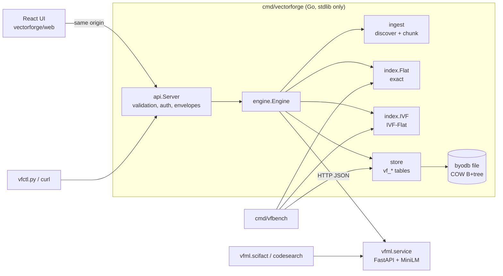
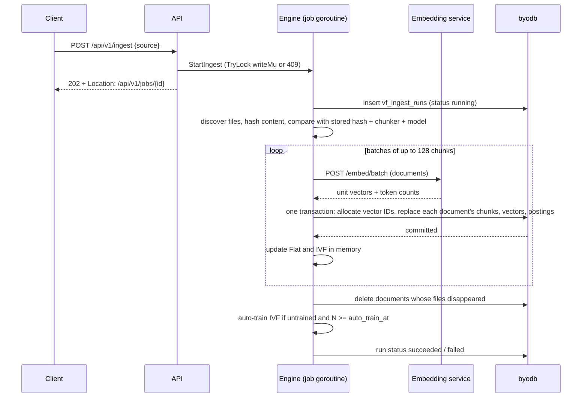
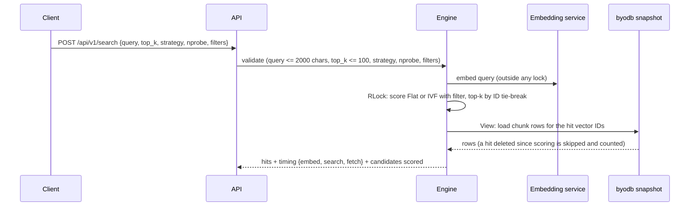

# VectorForge architecture

This document describes VectorForge as implemented. The design note
([vector-search-design.md](vector-search-design.md)) records why it is
shaped this way; measured numbers live in [benchmarks.md](benchmarks.md)
and [ml-methodology.md](ml-methodology.md).

- [Overview](#overview)
- [Packages](#packages)
- [Storage layout in byodb](#storage-layout-in-byodb)
- [Indexes](#indexes)
- [Write path: ingestion](#write-path-ingestion)
- [Read path: search](#read-path-search)
- [Startup and recovery](#startup-and-recovery)
- [Concurrency and consistency](#concurrency-and-consistency)
- [Embedding service](#embedding-service)
- [HTTP API](#http-api)
- [Security model](#security-model)
- [Limits](#limits)
- [Known limitations](#known-limitations)

## Overview

The byodb file is the source of truth. The two in-memory indexes are caches
rebuilt from it at startup: the exact index from the stored vectors, and the
IVF index from stored vectors, centroids and postings (no k-means at
startup). Every mutation is one byodb transaction, and memory is updated only
after that transaction commits.

## Packages

| Package | What it owns | Notable details |
| --- | --- | --- |
| `vectorforge/vector` | `Dot`, `Cosine`, `L2`, `Normalize`, `Validate`, float32 codec, segmenting, `TopK` | 4-way unrolled dot product; `TopK` is a bounded min-heap with ID tie-break so rankings are deterministic |
| `vectorforge/index` | `Flat`, `IVF`, `KMeans`, `RecallAtK` | Both indexes store vectors in contiguous `[]float32`; IVF lists swap-remove on delete |
| `vectorforge/store` | Schema and all reads/writes of `vf_*` tables | Refuses files containing any non-`vf_*` table; validates every vector before writing |
| `vectorforge/ingest` | Discovery, sanitization, chunkers, stable IDs | Go chunks via `go/parser` declarations; Markdown by heading; Python by top-level `def`/`class`; text by paragraph |
| `vectorforge/embed` | `Embedder` interface, HTTP client, deterministic `Hash` embedder for tests | Client re-validates and re-normalizes every vector and checks the model ID on every batch |
| `vectorforge/engine` | Startup load, ingest/upload/delete, search, rebuild, stats, verify, jobs | One writer at a time (`TryLock` → `ErrBusy`), readers under an `RWMutex` |
| `vectorforge/api` | HTTP routing, validation, error mapping, auth, static UI | Standard `net/http` 1.22 patterns, JSON envelopes, CSP |
| `vectorforge/hrtime` | 100 ns timer (QueryPerformanceCounter on Windows) | Go's monotonic clock on Windows advances in ~0.5 ms steps, which made sub-millisecond search timings read as 0 |
| `cmd/vectorforge` | Server binary and flags | Waits for the embedder, opens the engine, graceful shutdown |
| `cmd/vfbench` | Benchmarks | Synthetic, real-embedding and storage suites; JSON + CSV |
| `vectorforge/ml/vfml` | Embedding service, BM25, metrics, SciFact fine-tuning, code-search evaluation | Python 3.13, PyTorch CPU |
| `vectorforge/web` | React + TypeScript UI | No runtime dependencies besides React; charts are hand-written SVG |

## Storage layout in byodb

All state lives in ordinary byodb tables created through the public `DBTX`
API. The engine code of byodb is not modified.

| Table | Primary key | Columns | Purpose |
| --- | --- | --- | --- |
| `vf_meta` | `key` | `value` | Schema version, collection config (`dimension`, `metric`, `model_id`), `next_vector_id`, IVF metadata JSON |
| `vf_documents` | `doc_id` | source, path, kind, content hash, chunker version, model ID, size, chunk count, metadata, timestamps | One row per file or upload; secondary index on `(source, path)` |
| `vf_chunks` | `(doc_id, ordinal)` | vector ID, section, start/end line, tokens, text | Text is stored once, here; secondary index on `vector_id` resolves search hits |
| `vf_vectors` | `(vector_id, segment)` | doc ID, data | 256 float32 per segment (1 KiB raw) |
| `vf_ivf_centroids` | `(list_id, segment)` | data | Unit-norm centroids, same segmentation |
| `vf_ivf_postings` | `(list_id, vector_id)` | – | Inverted lists; secondary index on `vector_id` |
| `vf_ingest_runs` | `run_id` | status, timestamps, summary JSON | Ingestion history, including interrupted runs |

**Why segments.** byodb values are limited to 3,000 bytes and its key codec
escapes `0x00` and `0x01` by doubling them, so a 384-d vector (1,536 raw
bytes) can encode to 3,072 bytes in the worst case. A 1 KiB segment encodes to
at most 2 KiB plus framing and always fits. The store tests write adversarial
vectors made entirely of escape bytes to prove this.

**Identity.** `doc_id` is the first 16 hex characters of
`sha256(source + "\x00" + path)`, so the same file always maps to the same
document. `vector_id` comes from a counter in `vf_meta` and is never reused:
an updated document gets new vector IDs in the same transaction that deletes
the old ones, so a stale in-memory reference can never resolve to new text.

**Collection invariants.** One database holds one embedding space. The model
ID and dimension are written on first open; opening with an embedder that
reports a different model or dimension fails with `ErrConfigMismatch`, and
every embedded batch is checked against the configured model ID.

## Indexes

Both indexes assume unit-length vectors, so cosine similarity is a dot
product. Vectors with NaN/Inf values, zero norm or the wrong dimension are
rejected before any write.

**Exact (`index.Flat`).** A row-major matrix plus an ID slice and an
ID→row map. Search scores every row and keeps the best `k` in a min-heap:
`O(N·d)` time, `O(k)` extra space. Deletes swap the last row into the hole.
Exact search is used for small collections, for `strategy=exact`, and as the
ground truth for ANN recall.

**IVF-Flat (`index.IVF`).** `nlist` unit-norm centroids, each owning a list of
`(id, vector)` stored contiguously.

- *Training* is spherical k-means: k-means++ seeding, Lloyd iterations with
  centroids re-normalized after each update, up to 25 iterations or until the
  relative objective gain falls below `1e-4`. It trains on a seeded sample of
  at most `256 × nlist` vectors. Empty clusters are re-seeded from the
  worst-fitting point of the largest cluster. Assignment is parallel, and
  accumulation is in point order, so a seed and a data set always produce
  the same centroids (tested).
- *Search* scores the query against all centroids, keeps the best `nprobe`,
  and scans only those lists: about `nlist·d + nprobe·(N/nlist)·d`
  multiply-adds instead of `N·d`. `nprobe = nlist` returns exactly the exact
  result (tested).
- *Mutations* do not move centroids. An insert goes to its nearest existing
  centroid; a delete swap-removes from its list. The stats endpoint reports
  vectors added since training and the list imbalance factor
  (`Σ size² · nlist / N²`, 1.0 = perfectly even, which is also the expected
  cost multiplier for a query).
- *Defaults*: `nlist = round(√N)` and `nprobe = 8`; both overridable per
  rebuild and per query. The trade-off is measured in
  [benchmarks.md](benchmarks.md).

## Write path: ingestion

- **Change detection.** A file is skipped when its SHA-256 content hash,
  chunker version and model ID all match the stored document. Re-running an
  ingest that changed nothing embeds nothing.
- **Atomic per document.** A document's old chunks, vectors and postings
  are deleted and its new ones inserted in the same transaction, so a reader
  sees the old version or the new one, never a mix. A failed embedding call
  aborts the batch before any write.
- **Partial failure.** Committed batches stay committed. The next run
  skips them by hash and continues, so resume needs no special logic. An
  unreadable file keeps its previous version and is not pruned. The crash
  test kills a child process in the middle of an ingest (`os.Exit` after the
  third committed batch) and checks that every committed document is intact,
  that the run is marked `interrupted` on the next start, and that a re-run
  completes.
- **Chunking.** Go files are split at top-level declarations from
  `go/parser` (functions, methods with receivers, types, grouped var/const
  blocks), with oversized declarations split into numbered parts with two
  lines of overlap. Markdown splits at headings and keeps the heading path as
  the section label. Each chunk is embedded as `path · section\ntext`.
  Byte budgets differ per kind (700/900 bytes for prose, 480/640 for code)
  because code yields more tokens per byte under MiniLM's WordPiece (median
  2.5 bytes per token for Go versus 3.5 for Markdown, measured on the demo
  corpus); this cut the share of chunks truncated at 256 tokens from 65% to
  16%.

## Read path: search

`strategy=auto` uses IVF when it is trained and exact search otherwise.
Filters (kinds, sources, path prefix) are applied while scanning, before
top-k selection, so a filtered query still returns `top_k` hits when enough
match. With IVF, a filter does not widen the probe, so very selective filters
can return fewer hits than exist. `POST /search/compare` embeds once and runs
both strategies, returning recall@k of IVF against exact and the IDs IVF
missed.

## Startup and recovery

1. Open the byodb file. byodb's own recovery picks the newest valid meta
   page, so the state is the last committed transaction.
2. Check the collection config against the embedder (`/health`): same model
   ID and dimension, or refuse to start.
3. Stream `vf_documents` and `vf_vectors` into the exact index.
4. If IVF metadata exists, load centroids and postings and populate the IVF
   lists from the vectors already in memory. **The index is not retrained.**
   A vector without a posting is assigned to its nearest centroid and the
   posting is written back; postings without a vector are ignored and
   counted. The counts are in `GET /api/v1/index/stats` under `startup`.
5. Mark any ingest run still in `running` state as `interrupted`.

`ivf_retrained` in the startup report is always `false`. The engine test
asserts that after reopening, every vector is in the same list, the IVF
metadata (generation, training timestamp) is unchanged, and results are
identical; the end-to-end script checks that search results (IDs, ranks and
scores) are identical across a kill and restart of the real server.

## Concurrency and consistency

- **One writer.** Every mutation (ingest, upload, delete, rebuild) acquires
  `writeMu` with `TryLock`; a second concurrent mutation gets `409 busy`
  instead of queueing. Long mutations run as jobs that hold the lock until
  they finish. byodb's own file lock also stops a second process from
  opening the same file for writing (observed when a stale server was still
  running).
- **Readers never block on embedding or I/O of writers.** The in-memory
  indexes are guarded by an `RWMutex`; a writer takes the write lock only to
  swap in the effects of an already committed transaction.
- **No uncommitted reads.** Memory changes only after `Commit` returns, and
  search reads chunk text from a fresh database snapshot.
- **Rebuild is atomic.** k-means runs on a snapshot of the vectors while
  searches continue on the old index; the new centroids and postings replace
  the old ones in one transaction, then the in-memory index is swapped.
  A crash during a rebuild leaves the previous index.
- **Verification.** `GET /api/v1/index/verify` checks referential integrity
  across all `vf_*` tables (chunk counts, chunks ↔ vectors ↔ postings) and
  compares every stored vector with both in-memory indexes value by value.
  A test runs four searching goroutines (exact and IVF) while uploads,
  deletes and a rebuild happen, under `-race`, then verifies consistency.

## Embedding service

`vectorforge/ml/vfml/service.py` (FastAPI, Uvicorn) loads one Sentence
Transformers model on CPU.

| Endpoint | Behaviour |
| --- | --- |
| `GET /health` | `model_id` (name plus pinned revision, or fine-tuned artifact digest), dimension, max sequence length, batch limits |
| `POST /embed` | One text; `kind` = `query` or `document` |
| `POST /embed/batch` | Up to 256 texts; returns unit vectors, token counts and a truncation flag per text |

Inputs are validated (non-empty, length caps, batch size; 422 otherwise);
output vectors are L2-normalized in Python and checked again in Go. The Go
client sends batches of 64, retries 5xx and connection errors with backoff,
and never retries 4xx.

## HTTP API

Success responses are `{"data": …, "request_id": …}`; errors are
`{"error": {"code", "message"}, "request_id": …}`. Every response carries
`X-Request-ID`.

| Method and path | Success | Errors |
| --- | --- | --- |
| `GET /health` | 200 (`status` is `degraded` when the embedder is down) | |
| `GET /api/v1/sources` | 200 | |
| `POST /api/v1/ingest` `{source, force}` | 202 job, `Location` header | 400 unknown source, 409 busy, 403 read-only/auth |
| `GET /api/v1/documents?source&kind&path_prefix&offset&limit` | 200 page | 400 bad paging |
| `POST /api/v1/documents` `{path, content, kind?, metadata?}` | 201 created, 200 updated or unchanged | 400 invalid path/content, 413 too large, 409 busy |
| `GET /api/v1/documents/{id}` | 200 document + chunks | 404 |
| `DELETE /api/v1/documents/{id}` | 200 | 404, 409 busy |
| `POST /api/v1/search` | 200 | 400 validation, 409 `index_not_trained` for `ivf` before training, 503 embedder down, 504 timeout |
| `POST /api/v1/search/compare` | 200 | as search, plus 409 when IVF is untrained |
| `POST /api/v1/index/rebuild` `{nlist?, seed?, max_iterations?}` | 202 job | 400 impossible `nlist`, 409 busy |
| `GET /api/v1/index/stats` | 200 | |
| `GET /api/v1/index/verify` | 200 (`ok` false when inconsistent) | |
| `GET /api/v1/jobs`, `GET /api/v1/jobs/{id}` | 200 | 404 |
| `GET /api/v1/runs?limit` | 200 | |
| `GET /api/v1/benchmarks`, `GET /api/v1/benchmarks/{name}` | 200 | 404 for anything not in the listing |

Request bodies must be `application/json` (415 otherwise), unknown fields
are rejected, trailing data is rejected, and bodies are size-limited (413).
Unknown routes return JSON 404; a known path with the wrong method returns
JSON 405 with an `Allow` header.

## Security model

VectorForge is a single-user developer tool, not a multi-tenant service; the
controls are aimed at not leaking or modifying data by accident.

- **Ingestion only from configured roots.** Clients name a source; they
  cannot pass a filesystem path. Discovery skips `.git`, `node_modules`,
  virtual environments, build output, files over 512 KiB, binary and
  non-UTF-8 files, and anything matching the source's excludes. The demo
  sources are this repository and parts of the Go standard library.
- **Mutations.** With `VECTORFORGE_API_TOKEN` set, mutating endpoints require
  `Authorization: Bearer <token>` (constant-time comparison). Without a
  token, mutations are accepted only from loopback clients, and the binary
  warns when it listens on a non-loopback address without a token.
  `-read-only` opens the database read-only and rejects every mutation.
- **Browser requests.** Mutations with an `Origin` header that does not match
  the request host are rejected, which blocks cross-site form posts and
  `fetch` from other origins. The UI is served from the same origin under a
  strict Content Security Policy (`default-src 'self'`, no inline scripts or
  styles, `frame-ancestors 'none'`), plus `nosniff` and `no-referrer`.
- **Separate database.** The engine refuses to open a file that contains
  tables other than `vf_*`, so it cannot be pointed at the market
  service's database by mistake.
- **Benchmarks endpoint.** Serves only `.json` files that appear in a listing
  of the configured directory (one level of subdirectories), so request paths
  never reach the filesystem directly.

## Limits

| Limit | Value |
| --- | --- |
| Query length | 2,000 characters |
| `top_k` | 1–100 |
| `nlist` on rebuild | 1–4,096 and at most the number of vectors |
| Upload size | 256 KiB of text |
| Ingested file size | 512 KiB |
| Chunk text stored | 2,000 bytes |
| Metadata on upload | 16 entries |
| JSON request body | 64 KiB (uploads: 528 KiB) |
| Embedding batch | 256 texts per service request (the Go client sends 64) |

## Known limitations

- **Memory.** Both indexes keep every vector in RAM (about 1.5 KiB per
  384-d vector each, so roughly 3 KiB per vector total). There is no
  disk-resident scoring and no quantization.
- **Static centroids.** Inserts after training do not move centroids. Data
  that is unlike the training set can land in lists that queries do not
  probe. This was observed on the demo: a note about animals uploaded into a
  code corpus was rank 1 under exact search but missing from IVF results at
  `nprobe=8` (found at `nprobe=16`). Rebuild after large or off-distribution
  changes.
- **Filtered IVF.** Filters do not widen the probe, so selective filters can
  under-fill results.
- **Slow IVF persistence at scale.** Writing the trained state for 100k
  vectors (632 centroid rows and 100k postings plus their `vector_id` index
  entries, one transaction) took 24.3 s in the storage benchmark, longer than
  the 10.8 s k-means training itself; loading it back takes 0.2 s. This has
  not been profiled. Postings are written in list order, so the secondary
  index on `vector_id` receives keys in random order, which is a likely
  contributor in a copy-on-write B+tree. It is negligible for the demo
  corpus (7k vectors) and the reason rebuilds run as background jobs.
- **Storage overhead.** The 100k-vector benchmark file was 347.5 MB, 2.26×
  the raw float32 payload: B+tree page fill, the chunk and posting rows,
  secondary indexes and escape-coded segments all add to it.
- **One collection per file, one writer per file.** Concurrent writers are
  rejected rather than queued.
- **Windows durability.** byodb cannot fsync directories on Windows; see
  [`docs/DURABILITY.md`](../DURABILITY.md).
- **No HNSW.** IVF-Flat only; HNSW was an optional stretch goal.
