# VectorForge benchmark tables

Generated by `vectorforge/scripts/benchreport.py` from the JSON in `vectorforge/results/`. Do not edit by hand; rerun the script. Narrative and interpretation: [benchmarks.md](benchmarks.md).

## synthetic

`synthetic` suite — AMD Ryzen 5 5600 6-Core Processor, go1.26.0, GOMAXPROCS=12, commit `b5ebf7d` (dirty), timer QueryPerformanceCounter, wall 17.2 min, started 2026-10-18T01:10:03Z

### clustered-10k-384d

10,000 vectors × 384 dims, 1000 queries, kind `clustered`.

| exact search | p50 | p95 | p99 | QPS (1 goroutine) | index memory (est.) |
|---|---|---|---|---|---|
| flat scan | 1.26 ms | 1.89 ms | 2.65 ms | 740 | 18.3 MB |

Fastest IVF operating point reaching each recall@10 target (nlist / nprobe):

| target | nlist / nprobe | recall@10 | p50 | p99 | vectors scored | p50 speed-up vs exact |
|---|---|---|---|---|---|---|
| ≥ 0.90 | 400 / 8 | 0.901 | 84 µs | 180 µs | 2.0 % | 14.9× |
| ≥ 0.95 | 400 / 64 | 0.967 | 304 µs | 503 µs | 16.0 % | 4.2× |
| ≥ 0.99 | 400 / 256 | 0.998 | 863 µs | 1.34 ms | 64.0 % | 1.5× |

IVF builds:

| nlist | build | k-means iterations | converged | mean cos to centroid | list size min / mean / max | imbalance | memory (est.) |
|---|---|---|---|---|---|---|---|
| 50 | 0.6 s | 25 | yes | 0.226 | 162 / 200 / 251 | 1.01 | 17.9 MB |
| 100 | 0.5 s | 15 | yes | 0.291 | 64 / 100 / 147 | 1.03 | 18.2 MB |
| 200 | 1.8 s | 14 | yes | 0.383 | 23 / 50 / 103 | 1.06 | 18.8 MB |
| 400 | 2.0 s | 13 | yes | 0.508 | 7 / 25 / 50 | 1.12 | 19.2 MB |

All operating points

| nlist | nprobe | recall@1 | recall@10 | p50 | p95 | p99 | QPS | vectors scored |
|---|---|---|---|---|---|---|---|---|
| 50 | 1 | 0.768 | 0.695 | 36 µs | 53 µs | 68 µs | 26,492 | 2.0 % |
| 50 | 2 | 0.833 | 0.757 | 55 µs | 83 µs | 99 µs | 16,908 | 4.0 % |
| 50 | 4 | 0.888 | 0.812 | 101 µs | 150 µs | 180 µs | 9,128 | 8.0 % |
| 50 | 8 | 0.933 | 0.871 | 199 µs | 312 µs | 384 µs | 4,531 | 16.0 % |
| 50 | 16 | 0.969 | 0.928 | 368 µs | 634 µs | 943 µs | 2,327 | 32.0 % |
| 50 | 32 | 0.996 | 0.980 | 1.17 ms | 1.79 ms | 2.44 ms | 819 | 64.0 % |
| 100 | 1 | 0.834 | 0.749 | 28 µs | 40 µs | 55 µs | 33,956 | 1.0 % |
| 100 | 2 | 0.883 | 0.791 | 55 µs | 80 µs | 159 µs | 16,721 | 2.0 % |
| 100 | 4 | 0.910 | 0.827 | 85 µs | 131 µs | 290 µs | 10,965 | 4.0 % |
| 100 | 8 | 0.946 | 0.866 | 168 µs | 331 µs | 1.41 ms | 4,307 | 8.0 % |
| 100 | 16 | 0.971 | 0.910 | 289 µs | 416 µs | 691 µs | 3,309 | 16.0 % |
| 100 | 32 | 0.991 | 0.953 | 541 µs | 862 µs | 1.54 ms | 1,798 | 32.0 % |
| 100 | 64 | 0.999 | 0.989 | 1.07 ms | 1.71 ms | 2.84 ms | 882 | 64.0 % |
| 200 | 1 | 0.886 | 0.804 | 36 µs | 51 µs | 75 µs | 26,918 | 0.5 % |
| 200 | 2 | 0.906 | 0.830 | 36 µs | 58 µs | 77 µs | 24,817 | 1.0 % |
| 200 | 4 | 0.923 | 0.856 | 63 µs | 88 µs | 188 µs | 15,001 | 2.0 % |
| 200 | 8 | 0.959 | 0.889 | 73 µs | 111 µs | 148 µs | 12,589 | 4.0 % |
| 200 | 16 | 0.976 | 0.919 | 152 µs | 297 µs | 1.70 ms | 5,086 | 8.0 % |
| 200 | 32 | 0.985 | 0.947 | 300 µs | 467 µs | 1.22 ms | 3,036 | 16.0 % |
| 200 | 64 | 0.994 | 0.974 | 583 µs | 981 µs | 1.82 ms | 1,612 | 32.0 % |
| 200 | 128 | 1.000 | 0.995 | 986 µs | 1.92 ms | 3.72 ms | 885 | 64.0 % |
| 400 | 1 | 0.938 | 0.838 | 46 µs | 74 µs | 90 µs | 18,569 | 0.3 % |
| 400 | 2 | 0.951 | 0.860 | 64 µs | 82 µs | 94 µs | 15,608 | 0.5 % |
| 400 | 4 | 0.960 | 0.879 | 75 µs | 102 µs | 128 µs | 13,394 | 1.0 % |
| 400 | 8 | 0.969 | 0.901 | 84 µs | 120 µs | 180 µs | 11,330 | 2.0 % |
| 400 | 16 | 0.977 | 0.924 | 133 µs | 173 µs | 259 µs | 7,516 | 4.0 % |
| 400 | 32 | 0.989 | 0.948 | 206 µs | 320 µs | 810 µs | 4,229 | 8.0 % |
| 400 | 64 | 0.991 | 0.967 | 304 µs | 412 µs | 503 µs | 3,256 | 16.0 % |
| 400 | 128 | 0.997 | 0.987 | 513 µs | 692 µs | 787 µs | 1,891 | 32.0 % |
| 400 | 256 | 1.000 | 0.998 | 863 µs | 1.23 ms | 1.34 ms | 1,079 | 64.0 % |

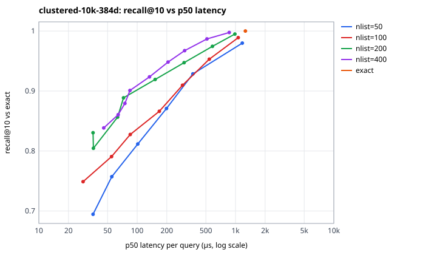

### clustered-100k-384d

100,000 vectors × 384 dims, 1000 queries, kind `clustered`.

| exact search | p50 | p95 | p99 | QPS (1 goroutine) | index memory (est.) |
|---|---|---|---|---|---|
| flat scan | 13.49 ms | 17.66 ms | 24.51 ms | 72 | 170.5 MB |

Fastest IVF operating point reaching each recall@10 target (nlist / nprobe):

| target | nlist / nprobe | recall@10 | p50 | p99 | vectors scored | p50 speed-up vs exact |
|---|---|---|---|---|---|---|
| ≥ 0.90 | 316 / 1 | 1.000 | 80 µs | 153 µs | 0.4 % | 168.2× |
| ≥ 0.95 | 316 / 1 | 1.000 | 80 µs | 153 µs | 0.4 % | 168.2× |
| ≥ 0.99 | 316 / 1 | 1.000 | 80 µs | 153 µs | 0.4 % | 168.2× |

IVF builds:

| nlist | build | k-means iterations | converged | mean cos to centroid | list size min / mean / max | imbalance | memory (est.) |
|---|---|---|---|---|---|---|---|
| 158 | 4.1 s | 15 | yes | 0.329 | 311 / 633 / 1098 | 1.06 | 178.0 MB |
| 316 | 8.4 s | 9 | yes | 0.434 | 86 / 316 / 619 | 1.11 | 178.6 MB |
| 632 | 19.3 s | 8 | yes | 0.575 | 76 / 158 / 427 | 1.18 | 179.2 MB |
| 1264 | 38.2 s | 7 | yes | 0.706 | 1 / 79 / 206 | 1.19 | 181.0 MB |

All operating points

| nlist | nprobe | recall@1 | recall@10 | p50 | p95 | p99 | QPS | vectors scored |
|---|---|---|---|---|---|---|---|---|
| 158 | 1 | 0.991 | 0.990 | 125 µs | 200 µs | 255 µs | 7,631 | 0.7 % |
| 158 | 2 | 0.994 | 0.993 | 243 µs | 419 µs | 497 µs | 3,911 | 1.3 % |
| 158 | 4 | 0.996 | 0.996 | 382 µs | 613 µs | 837 µs | 2,445 | 2.6 % |
| 158 | 8 | 0.998 | 0.998 | 902 µs | 1.45 ms | 1.74 ms | 1,068 | 5.1 % |
| 158 | 16 | 0.999 | 0.999 | 1.64 ms | 2.81 ms | 4.14 ms | 568 | 10.2 % |
| 158 | 32 | 1.000 | 1.000 | 2.60 ms | 3.53 ms | 4.25 ms | 367 | 20.3 % |
| 158 | 64 | 1.000 | 1.000 | 5.24 ms | 7.18 ms | 8.71 ms | 182 | 40.6 % |
| 158 | 128 | 1.000 | 1.000 | 10.41 ms | 12.82 ms | 17.49 ms | 93 | 81.0 % |
| 316 | 1 | 1.000 | 1.000 | 80 µs | 126 µs | 153 µs | 11,726 | 0.4 % |
| 316 | 2 | 1.000 | 1.000 | 112 µs | 165 µs | 192 µs | 8,549 | 0.7 % |
| 316 | 4 | 1.000 | 1.000 | 193 µs | 299 µs | 347 µs | 4,873 | 1.3 % |
| 316 | 8 | 1.000 | 1.000 | 343 µs | 529 µs | 599 µs | 2,716 | 2.6 % |
| 316 | 16 | 1.000 | 1.000 | 662 µs | 960 µs | 1.05 ms | 1,429 | 5.1 % |
| 316 | 32 | 1.000 | 1.000 | 1.77 ms | 3.01 ms | 6.02 ms | 521 | 10.1 % |
| 316 | 64 | 1.000 | 1.000 | 2.68 ms | 3.99 ms | 4.62 ms | 349 | 20.3 % |
| 316 | 128 | 1.000 | 1.000 | 5.60 ms | 7.74 ms | 10.12 ms | 171 | 40.5 % |
| 316 | 256 | 1.000 | 1.000 | 9.91 ms | 12.38 ms | 15.24 ms | 97 | 81.0 % |
| 632 | 1 | 1.000 | 1.000 | 96 µs | 152 µs | 205 µs | 9,688 | 0.2 % |
| 632 | 2 | 1.000 | 1.000 | 144 µs | 212 µs | 298 µs | 6,644 | 0.3 % |
| 632 | 4 | 1.000 | 1.000 | 196 µs | 300 µs | 410 µs | 4,897 | 0.7 % |
| 632 | 8 | 1.000 | 1.000 | 282 µs | 422 µs | 628 µs | 3,391 | 1.3 % |
| 632 | 16 | 1.000 | 1.000 | 431 µs | 634 µs | 826 µs | 2,198 | 2.6 % |
| 632 | 32 | 1.000 | 1.000 | 707 µs | 1.04 ms | 1.13 ms | 1,326 | 5.1 % |
| 632 | 64 | 1.000 | 1.000 | 1.32 ms | 1.87 ms | 2.00 ms | 718 | 10.2 % |
| 632 | 128 | 1.000 | 1.000 | 2.70 ms | 3.91 ms | 4.75 ms | 345 | 20.3 % |
| 632 | 256 | 1.000 | 1.000 | 5.53 ms | 7.03 ms | 7.93 ms | 177 | 40.5 % |
| 1264 | 1 | 0.939 | 0.935 | 219 µs | 332 µs | 509 µs | 4,353 | 0.1 % |
| 1264 | 2 | 0.996 | 0.998 | 234 µs | 405 µs | 788 µs | 3,195 | 0.2 % |
| 1264 | 4 | 1.000 | 1.000 | 275 µs | 447 µs | 756 µs | 3,461 | 0.3 % |
| 1264 | 8 | 1.000 | 1.000 | 347 µs | 465 µs | 664 µs | 2,801 | 0.6 % |
| 1264 | 16 | 1.000 | 1.000 | 484 µs | 704 µs | 1.60 ms | 1,911 | 1.3 % |
| 1264 | 32 | 1.000 | 1.000 | 790 µs | 2.44 ms | 6.45 ms | 917 | 2.6 % |
| 1264 | 64 | 1.000 | 1.000 | 1.40 ms | 3.28 ms | 5.48 ms | 609 | 5.1 % |
| 1264 | 128 | 1.000 | 1.000 | 1.91 ms | 2.61 ms | 4.09 ms | 511 | 10.1 % |
| 1264 | 256 | 1.000 | 1.000 | 2.84 ms | 3.78 ms | 4.13 ms | 337 | 20.3 % |

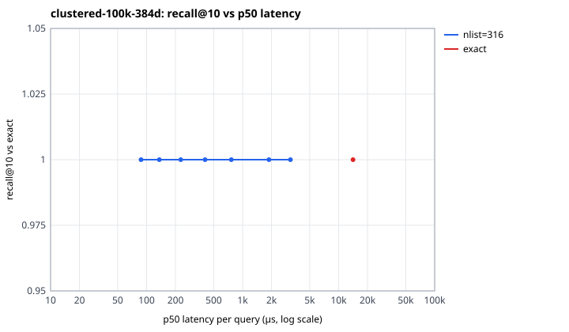

Effect of k:

| k | strategy | nprobe | recall@k | p50 | p99 | QPS |
|---|---|---|---|---|---|---|
| 1 | exact |  | 1.000 | 13.24 ms | 22.62 ms | 74 |
| 1 | ivf | 1 | 1.000 | 87 µs | 181 µs | 10,880 |
| 10 | exact |  | 1.000 | 12.95 ms | 21.83 ms | 75 |
| 10 | ivf | 1 | 1.000 | 88 µs | 160 µs | 10,877 |
| 50 | exact |  | 1.000 | 12.77 ms | 18.53 ms | 77 |
| 50 | ivf | 1 | 1.000 | 93 µs | 167 µs | 10,287 |
| 100 | exact |  | 1.000 | 12.59 ms | 15.88 ms | 78 |
| 100 | ivf | 1 | 0.962 | 96 µs | 178 µs | 9,769 |

Concurrent searches against one shared read-only index:

| strategy | nprobe | goroutines | QPS | speed-up vs 1 | p50 | p99 |
|---|---|---|---|---|---|---|
| exact |  | 1 | 65 | 1.00× | 13.62 ms | 36.41 ms |
| exact |  | 2 | 102 | 1.57× | 18.47 ms | 39.44 ms |
| exact |  | 4 | 152 | 2.33× | 24.32 ms | 59.30 ms |
| exact |  | 6 | 158 | 2.42× | 33.80 ms | 128 ms |
| exact |  | 8 | 194 | 2.98× | 38.00 ms | 110 ms |
| exact |  | 12 | 193 | 2.96× | 48.07 ms | 429 ms |
| ivf | 1 | 1 | 8,519 | 1.00× | 109 µs | 285 µs |
| ivf | 1 | 2 | 17,757 | 2.08× | 105 µs | 249 µs |
| ivf | 1 | 4 | 26,226 | 3.08× | 132 µs | 617 µs |
| ivf | 1 | 6 | 28,113 | 3.30× | 147 µs | 1.77 ms |
| ivf | 1 | 8 | 39,821 | 4.67× | 149 µs | 1.32 ms |
| ivf | 1 | 12 | 49,948 | 5.86× | 156 µs | 2.09 ms |

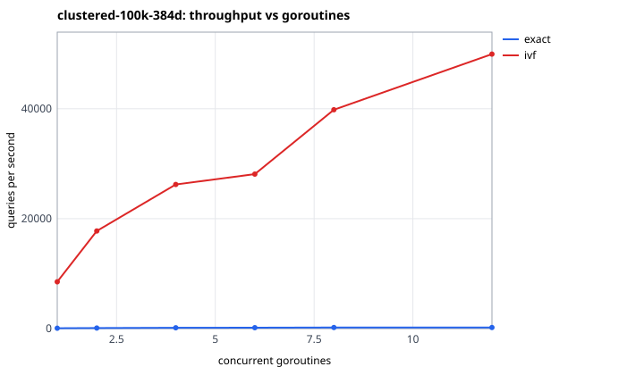

### clustered-500k-384d

500,000 vectors × 384 dims, 1000 queries, kind `clustered`.

| exact search | p50 | p95 | p99 | QPS (1 goroutine) | index memory (est.) |
|---|---|---|---|---|---|
| flat scan | 76.65 ms | 113 ms | 144 ms | 12 | 814.0 MB |

Fastest IVF operating point reaching each recall@10 target (nlist / nprobe):

| target | nlist / nprobe | recall@10 | p50 | p99 | vectors scored | p50 speed-up vs exact |
|---|---|---|---|---|---|---|
| ≥ 0.90 | 707 / 1 | 1.000 | 311 µs | 2.59 ms | 0.2 % | 246.3× |
| ≥ 0.95 | 707 / 1 | 1.000 | 311 µs | 2.59 ms | 0.2 % | 246.3× |
| ≥ 0.99 | 707 / 1 | 1.000 | 311 µs | 2.59 ms | 0.2 % | 246.3× |

IVF builds:

| nlist | build | k-means iterations | converged | mean cos to centroid | list size min / mean / max | imbalance | memory (est.) |
|---|---|---|---|---|---|---|---|
| 353 | 20.4 s | 9 | yes | 0.452 | 457 / 1416 / 3021 | 1.12 | 892.8 MB |
| 707 | 48.9 s | 7 | yes | 0.600 | 203 / 707 / 1572 | 1.19 | 894.1 MB |
| 1414 | 150.6 s | 6 | yes | 0.708 | 1 / 354 / 1023 | 1.26 | 895.9 MB |

All operating points

| nlist | nprobe | recall@1 | recall@10 | p50 | p95 | p99 | QPS | vectors scored |
|---|---|---|---|---|---|---|---|---|
| 353 | 1 | 1.000 | 1.000 | 337 µs | 581 µs | 890 µs | 2,757 | 0.3 % |
| 353 | 2 | 1.000 | 1.000 | 616 µs | 1.18 ms | 1.62 ms | 1,475 | 0.6 % |
| 353 | 4 | 1.000 | 1.000 | 974 µs | 1.44 ms | 1.90 ms | 999 | 1.2 % |
| 353 | 8 | 1.000 | 1.000 | 1.75 ms | 3.41 ms | 6.55 ms | 478 | 2.3 % |
| 353 | 16 | 1.000 | 1.000 | 3.37 ms | 4.38 ms | 6.56 ms | 290 | 4.6 % |
| 353 | 32 | 1.000 | 1.000 | 6.59 ms | 8.43 ms | 10.81 ms | 147 | 9.1 % |
| 353 | 64 | 1.000 | 1.000 | 12.98 ms | 17.71 ms | 22.08 ms | 74 | 18.1 % |
| 353 | 128 | 1.000 | 1.000 | 25.49 ms | 30.99 ms | 40.13 ms | 38 | 36.2 % |
| 353 | 256 | 1.000 | 1.000 | 50.33 ms | 63.03 ms | 82.68 ms | 19 | 72.5 % |
| 707 | 1 | 1.000 | 1.000 | 311 µs | 608 µs | 2.59 ms | 2,660 | 0.2 % |
| 707 | 2 | 1.000 | 1.000 | 532 µs | 1.85 ms | 3.94 ms | 1,381 | 0.3 % |
| 707 | 4 | 1.000 | 1.000 | 875 µs | 2.66 ms | 5.24 ms | 865 | 0.6 % |
| 707 | 8 | 1.000 | 1.000 | 1.62 ms | 3.15 ms | 4.59 ms | 542 | 1.2 % |
| 707 | 16 | 1.000 | 1.000 | 1.81 ms | 2.44 ms | 2.96 ms | 538 | 2.3 % |
| 707 | 32 | 1.000 | 1.000 | 4.50 ms | 6.49 ms | 9.17 ms | 217 | 4.5 % |
| 707 | 64 | 1.000 | 1.000 | 6.62 ms | 9.38 ms | 11.76 ms | 144 | 9.1 % |
| 707 | 128 | 1.000 | 1.000 | 13.34 ms | 15.73 ms | 18.44 ms | 74 | 18.1 % |
| 707 | 256 | 1.000 | 1.000 | 26.90 ms | 32.00 ms | 48.43 ms | 36 | 36.2 % |
| 1414 | 1 | 0.912 | 0.904 | 350 µs | 503 µs | 1.00 ms | 2,678 | 0.1 % |
| 1414 | 2 | 0.994 | 0.994 | 347 µs | 463 µs | 555 µs | 2,848 | 0.2 % |
| 1414 | 4 | 0.999 | 0.999 | 404 µs | 588 µs | 675 µs | 2,405 | 0.3 % |
| 1414 | 8 | 1.000 | 1.000 | 585 µs | 850 µs | 947 µs | 1,649 | 0.6 % |
| 1414 | 16 | 1.000 | 1.000 | 1.08 ms | 1.51 ms | 1.75 ms | 912 | 1.1 % |
| 1414 | 32 | 1.000 | 1.000 | 1.85 ms | 2.50 ms | 2.81 ms | 528 | 2.3 % |
| 1414 | 64 | 1.000 | 1.000 | 3.61 ms | 4.57 ms | 5.08 ms | 275 | 4.5 % |
| 1414 | 128 | 1.000 | 1.000 | 6.83 ms | 8.37 ms | 10.10 ms | 144 | 9.1 % |
| 1414 | 256 | 1.000 | 1.000 | 13.36 ms | 15.77 ms | 21.96 ms | 73 | 18.1 % |

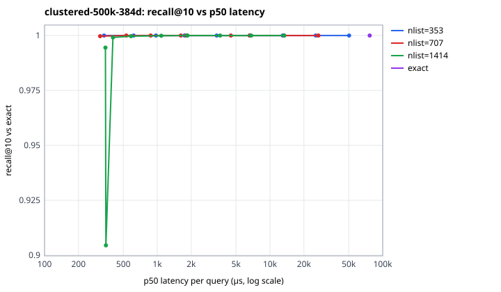

### isotropic-100k-384d

100,000 vectors × 384 dims, 1000 queries, kind `isotropic`.

| exact search | p50 | p95 | p99 | QPS (1 goroutine) | index memory (est.) |
|---|---|---|---|---|---|
| flat scan | 14.88 ms | 18.67 ms | 23.81 ms | 65 | 170.5 MB |

Fastest IVF operating point reaching each recall@10 target (nlist / nprobe):

| target | nlist / nprobe | recall@10 | p50 | p99 | vectors scored | p50 speed-up vs exact |
|---|---|---|---|---|---|---|
| ≥ 0.90 | 316 / 256 | 0.942 | 11.57 ms | 22.15 ms | 81.0 % | 1.3× |
| ≥ 0.95 | not reached |  |  |  |  |  |
| ≥ 0.99 | not reached |  |  |  |  |  |

IVF builds:

| nlist | build | k-means iterations | converged | mean cos to centroid | list size min / mean / max | imbalance | memory (est.) |
|---|---|---|---|---|---|---|---|
| 158 | 6.6 s | 25 | no | 0.171 | 584 / 633 / 692 | 1.00 | 182.6 MB |
| 316 | 25.2 s | 25 | no | 0.181 | 278 / 316 / 361 | 1.00 | 178.9 MB |
| 632 | 44.3 s | 21 | yes | 0.199 | 128 / 158 / 187 | 1.00 | 182.6 MB |
| 1264 | 72.2 s | 15 | yes | 0.225 | 59 / 79 / 106 | 1.01 | 183.7 MB |

All operating points

| nlist | nprobe | recall@1 | recall@10 | p50 | p95 | p99 | QPS | vectors scored |
|---|---|---|---|---|---|---|---|---|
| 158 | 1 | 0.037 | 0.027 | 112 µs | 148 µs | 180 µs | 8,752 | 0.6 % |
| 158 | 2 | 0.065 | 0.049 | 212 µs | 285 µs | 378 µs | 4,695 | 1.3 % |
| 158 | 4 | 0.099 | 0.083 | 409 µs | 547 µs | 718 µs | 2,414 | 2.5 % |
| 158 | 8 | 0.152 | 0.141 | 780 µs | 1.03 ms | 1.18 ms | 1,270 | 5.1 % |
| 158 | 16 | 0.264 | 0.238 | 1.55 ms | 2.01 ms | 2.28 ms | 639 | 10.1 % |
| 158 | 32 | 0.416 | 0.395 | 3.04 ms | 3.76 ms | 5.37 ms | 319 | 20.2 % |
| 158 | 64 | 0.666 | 0.635 | 6.00 ms | 7.13 ms | 7.73 ms | 164 | 40.5 % |
| 158 | 128 | 0.942 | 0.930 | 12.36 ms | 14.96 ms | 20.35 ms | 79 | 81.0 % |
| 316 | 1 | 0.022 | 0.017 | 87 µs | 121 µs | 164 µs | 11,161 | 0.3 % |
| 316 | 2 | 0.039 | 0.029 | 135 µs | 189 µs | 251 µs | 7,227 | 0.6 % |
| 316 | 4 | 0.071 | 0.054 | 246 µs | 329 µs | 450 µs | 4,009 | 1.3 % |
| 316 | 8 | 0.106 | 0.095 | 445 µs | 640 µs | 842 µs | 2,186 | 2.5 % |
| 316 | 16 | 0.175 | 0.163 | 857 µs | 1.21 ms | 1.69 ms | 1,131 | 5.1 % |
| 316 | 32 | 0.299 | 0.272 | 1.55 ms | 2.11 ms | 2.75 ms | 618 | 10.1 % |
| 316 | 64 | 0.471 | 0.435 | 3.50 ms | 5.01 ms | 6.96 ms | 274 | 20.3 % |
| 316 | 128 | 0.697 | 0.670 | 5.86 ms | 7.16 ms | 8.88 ms | 167 | 40.5 % |
| 316 | 256 | 0.943 | 0.942 | 11.57 ms | 14.08 ms | 22.15 ms | 84 | 81.0 % |
| 632 | 1 | 0.024 | 0.016 | 93 µs | 142 µs | 174 µs | 9,567 | 0.2 % |
| 632 | 2 | 0.039 | 0.028 | 131 µs | 170 µs | 187 µs | 7,506 | 0.3 % |
| 632 | 4 | 0.057 | 0.046 | 158 µs | 235 µs | 256 µs | 5,841 | 0.6 % |
| 632 | 8 | 0.089 | 0.073 | 239 µs | 341 µs | 371 µs | 3,909 | 1.3 % |
| 632 | 16 | 0.145 | 0.118 | 420 µs | 582 µs | 639 µs | 2,269 | 2.5 % |
| 632 | 32 | 0.227 | 0.189 | 786 µs | 1.02 ms | 1.06 ms | 1,236 | 5.1 % |
| 632 | 64 | 0.347 | 0.299 | 1.47 ms | 1.92 ms | 2.26 ms | 648 | 10.1 % |
| 632 | 128 | 0.513 | 0.471 | 2.93 ms | 3.97 ms | 5.30 ms | 324 | 20.3 % |
| 632 | 256 | 0.720 | 0.705 | 5.79 ms | 7.03 ms | 7.34 ms | 170 | 40.5 % |
| 1264 | 1 | 0.013 | 0.012 | 198 µs | 250 µs | 302 µs | 5,068 | 0.1 % |
| 1264 | 2 | 0.017 | 0.022 | 200 µs | 264 µs | 311 µs | 4,878 | 0.2 % |
| 1264 | 4 | 0.036 | 0.035 | 215 µs | 288 µs | 306 µs | 4,517 | 0.3 % |
| 1264 | 8 | 0.060 | 0.053 | 270 µs | 352 µs | 407 µs | 3,616 | 0.6 % |
| 1264 | 16 | 0.100 | 0.084 | 373 µs | 473 µs | 538 µs | 2,658 | 1.3 % |
| 1264 | 32 | 0.168 | 0.137 | 596 µs | 739 µs | 806 µs | 1,673 | 2.5 % |
| 1264 | 64 | 0.268 | 0.219 | 981 µs | 1.21 ms | 1.33 ms | 1,007 | 5.1 % |
| 1264 | 128 | 0.403 | 0.338 | 1.82 ms | 2.13 ms | 2.23 ms | 554 | 10.1 % |
| 1264 | 256 | 0.570 | 0.510 | 3.43 ms | 4.04 ms | 4.87 ms | 289 | 20.3 % |

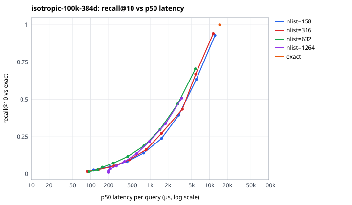

## dims

`dims` suite — AMD Ryzen 5 5600 6-Core Processor, go1.26.0, GOMAXPROCS=12, commit `b5ebf7d` (dirty), timer QueryPerformanceCounter, wall 1.9 min, started 2026-10-18T01:27:29Z

### clustered-100k-128d

100,000 vectors × 128 dims, 1000 queries, kind `clustered`.

| exact search | p50 | p95 | p99 | QPS (1 goroutine) | index memory (est.) |
|---|---|---|---|---|---|
| flat scan | 5.24 ms | 6.56 ms | 6.88 ms | 189 | 68.0 MB |

Fastest IVF operating point reaching each recall@10 target (nlist / nprobe):

| target | nlist / nprobe | recall@10 | p50 | p99 | vectors scored | p50 speed-up vs exact |
|---|---|---|---|---|---|---|
| ≥ 0.90 | 316 / 1 | 0.981 | 34 µs | 60 µs | 0.3 % | 154.7× |
| ≥ 0.95 | 316 / 1 | 0.981 | 34 µs | 60 µs | 0.3 % | 154.7× |
| ≥ 0.99 | 316 / 4 | 0.990 | 99 µs | 140 µs | 1.3 % | 53.1× |

IVF builds:

| nlist | build | k-means iterations | converged | mean cos to centroid | list size min / mean / max | imbalance | memory (est.) |
|---|---|---|---|---|---|---|---|
| 316 | 6.9 s | 22 | yes | 0.472 | 88 / 316 / 555 | 1.08 | 62.6 MB |

All operating points

| nlist | nprobe | recall@1 | recall@10 | p50 | p95 | p99 | QPS | vectors scored |
|---|---|---|---|---|---|---|---|---|
| 316 | 1 | 0.981 | 0.981 | 34 µs | 51 µs | 60 µs | 28,244 | 0.3 % |
| 316 | 2 | 0.986 | 0.986 | 59 µs | 80 µs | 92 µs | 17,115 | 0.7 % |
| 316 | 4 | 0.990 | 0.990 | 99 µs | 131 µs | 140 µs | 10,218 | 1.3 % |
| 316 | 8 | 0.994 | 0.992 | 166 µs | 224 µs | 250 µs | 5,969 | 2.6 % |
| 316 | 16 | 0.996 | 0.995 | 311 µs | 417 µs | 515 µs | 3,184 | 5.1 % |
| 316 | 32 | 0.997 | 0.997 | 598 µs | 797 µs | 898 µs | 1,648 | 10.1 % |
| 316 | 64 | 0.998 | 0.999 | 1.28 ms | 2.42 ms | 3.67 ms | 693 | 20.2 % |

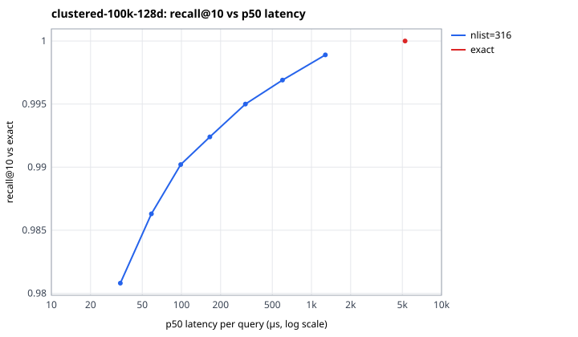

### clustered-100k-384d

100,000 vectors × 384 dims, 1000 queries, kind `clustered`.

| exact search | p50 | p95 | p99 | QPS (1 goroutine) | index memory (est.) |
|---|---|---|---|---|---|
| flat scan | 14.13 ms | 21.54 ms | 28.72 ms | 66 | 170.5 MB |

Fastest IVF operating point reaching each recall@10 target (nlist / nprobe):

| target | nlist / nprobe | recall@10 | p50 | p99 | vectors scored | p50 speed-up vs exact |
|---|---|---|---|---|---|---|
| ≥ 0.90 | 316 / 1 | 1.000 | 88 µs | 172 µs | 0.4 % | 161.4× |
| ≥ 0.95 | 316 / 1 | 1.000 | 88 µs | 172 µs | 0.4 % | 161.4× |
| ≥ 0.99 | 316 / 1 | 1.000 | 88 µs | 172 µs | 0.4 % | 161.4× |

IVF builds:

| nlist | build | k-means iterations | converged | mean cos to centroid | list size min / mean / max | imbalance | memory (est.) |
|---|---|---|---|---|---|---|---|
| 316 | 11.3 s | 9 | yes | 0.434 | 86 / 316 / 619 | 1.11 | 178.6 MB |

All operating points

| nlist | nprobe | recall@1 | recall@10 | p50 | p95 | p99 | QPS | vectors scored |
|---|---|---|---|---|---|---|---|---|
| 316 | 1 | 1.000 | 1.000 | 88 µs | 136 µs | 172 µs | 10,798 | 0.4 % |
| 316 | 2 | 1.000 | 1.000 | 136 µs | 202 µs | 242 µs | 7,082 | 0.7 % |
| 316 | 4 | 1.000 | 1.000 | 227 µs | 340 µs | 472 µs | 4,231 | 1.3 % |
| 316 | 8 | 1.000 | 1.000 | 407 µs | 589 µs | 759 µs | 2,346 | 2.6 % |
| 316 | 16 | 1.000 | 1.000 | 762 µs | 1.10 ms | 1.96 ms | 1,215 | 5.1 % |
| 316 | 32 | 1.000 | 1.000 | 1.88 ms | 3.00 ms | 3.91 ms | 512 | 10.1 % |
| 316 | 64 | 1.000 | 1.000 | 3.15 ms | 5.06 ms | 7.83 ms | 294 | 20.3 % |

### clustered-100k-768d

100,000 vectors × 768 dims, 1000 queries, kind `clustered`.

| exact search | p50 | p95 | p99 | QPS (1 goroutine) | index memory (est.) |
|---|---|---|---|---|---|
| flat scan | 27.82 ms | 36.07 ms | 45.61 ms | 35 | 380.9 MB |

Fastest IVF operating point reaching each recall@10 target (nlist / nprobe):

| target | nlist / nprobe | recall@10 | p50 | p99 | vectors scored | p50 speed-up vs exact |
|---|---|---|---|---|---|---|
| ≥ 0.90 | 316 / 1 | 1.000 | 180 µs | 332 µs | 0.4 % | 154.5× |
| ≥ 0.95 | 316 / 1 | 1.000 | 180 µs | 332 µs | 0.4 % | 154.5× |
| ≥ 0.99 | 316 / 1 | 1.000 | 180 µs | 332 µs | 0.4 % | 154.5× |

IVF builds:

| nlist | build | k-means iterations | converged | mean cos to centroid | list size min / mean / max | imbalance | memory (est.) |
|---|---|---|---|---|---|---|---|
| 316 | 19.9 s | 8 | yes | 0.417 | 81 / 316 / 676 | 1.12 | 357.2 MB |

All operating points

| nlist | nprobe | recall@1 | recall@10 | p50 | p95 | p99 | QPS | vectors scored |
|---|---|---|---|---|---|---|---|---|
| 316 | 1 | 1.000 | 1.000 | 180 µs | 276 µs | 332 µs | 5,301 | 0.4 % |
| 316 | 2 | 1.000 | 1.000 | 263 µs | 400 µs | 460 µs | 3,632 | 0.7 % |
| 316 | 4 | 1.000 | 1.000 | 466 µs | 712 µs | 1.11 ms | 2,039 | 1.3 % |
| 316 | 8 | 1.000 | 1.000 | 857 µs | 1.25 ms | 1.71 ms | 1,119 | 2.6 % |
| 316 | 16 | 1.000 | 1.000 | 1.55 ms | 2.18 ms | 2.87 ms | 612 | 5.1 % |
| 316 | 32 | 1.000 | 1.000 | 2.94 ms | 3.80 ms | 6.24 ms | 327 | 10.2 % |
| 316 | 64 | 1.000 | 1.000 | 5.79 ms | 6.92 ms | 7.37 ms | 171 | 20.3 % |

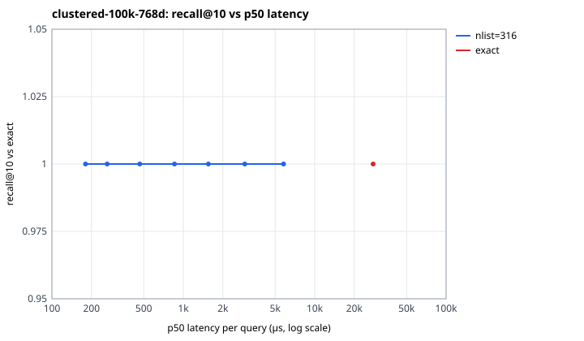

## real

`real` suite — AMD Ryzen 5 5600 6-Core Processor, go1.26.0, GOMAXPROCS=12, commit `b5ebf7d` (dirty), timer QueryPerformanceCounter, wall 30.8 min, started 2026-10-18T02:01:41Z

### scifact-pretrained

5,183 vectors × 384 dims, 300 queries, kind `real`, from `vectorforge/ml/artifacts/scifact/pretrained/export`.

| exact search | p50 | p95 | p99 | QPS (1 goroutine) | index memory (est.) |
|---|---|---|---|---|---|
| flat scan | 806 µs | 1.10 ms | 1.31 ms | 1,196 | 9.3 MB |

Fastest IVF operating point reaching each recall@10 target (nlist / nprobe):

| target | nlist / nprobe | recall@10 | p50 | p99 | vectors scored | p50 speed-up vs exact |
|---|---|---|---|---|---|---|
| ≥ 0.90 | 144 / 16 | 0.908 | 135 µs | 289 µs | 12.0 % | 6.0× |
| ≥ 0.95 | 144 / 32 | 0.969 | 222 µs | 423 µs | 23.6 % | 3.6× |
| ≥ 0.99 | 288 / 128 | 0.997 | 470 µs | 843 µs | 48.0 % | 1.7× |

IVF builds:

| nlist | build | k-means iterations | converged | mean cos to centroid | list size min / mean / max | imbalance | memory (est.) |
|---|---|---|---|---|---|---|---|
| 36 | 0.2 s | 19 | yes | 0.584 | 60 / 144 / 286 | 1.12 | 9.3 MB |
| 72 | 0.3 s | 17 | yes | 0.620 | 27 / 72 / 168 | 1.17 | 9.4 MB |
| 144 | 0.6 s | 13 | yes | 0.659 | 7 / 36 / 93 | 1.19 | 9.7 MB |
| 288 | 0.8 s | 13 | yes | 0.699 | 1 / 18 / 63 | 1.29 | 10.0 MB |

All operating points

| nlist | nprobe | recall@1 | recall@10 | recall@100 | p50 | p95 | p99 | QPS | vectors scored |
|---|---|---|---|---|---|---|---|---|---|
| 36 | 1 | 0.603 | 0.530 | 0.374 | 30 µs | 48 µs | 81 µs | 31,174 | 3.1 % |
| 36 | 2 | 0.737 | 0.685 | 0.549 | 62 µs | 100 µs | 137 µs | 15,395 | 6.1 % |
| 36 | 4 | 0.870 | 0.823 | 0.727 | 106 µs | 161 µs | 200 µs | 9,163 | 12.1 % |
| 36 | 8 | 0.957 | 0.917 | 0.871 | 200 µs | 326 µs | 414 µs | 4,646 | 24.0 % |
| 36 | 16 | 0.987 | 0.979 | 0.966 | 360 µs | 528 µs | 648 µs | 2,662 | 47.8 % |
| 36 | 32 | 1.000 | 1.000 | 1.000 | 649 µs | 955 µs | 1.05 ms | 1,432 | 90.4 % |
| 72 | 1 | 0.610 | 0.497 | 0.285 | 24 µs | 39 µs | 58 µs | 37,647 | 1.5 % |
| 72 | 2 | 0.747 | 0.650 | 0.450 | 43 µs | 66 µs | 95 µs | 21,746 | 3.1 % |
| 72 | 4 | 0.860 | 0.775 | 0.612 | 60 µs | 93 µs | 142 µs | 15,661 | 6.2 % |
| 72 | 8 | 0.927 | 0.870 | 0.770 | 108 µs | 161 µs | 179 µs | 8,726 | 12.1 % |
| 72 | 16 | 0.970 | 0.947 | 0.899 | 191 µs | 305 µs | 448 µs | 4,866 | 23.9 % |
| 72 | 32 | 0.997 | 0.989 | 0.977 | 392 µs | 575 µs | 729 µs | 2,421 | 47.9 % |
| 72 | 64 | 1.000 | 1.000 | 1.000 | 698 µs | 986 µs | 1.11 ms | 1,345 | 90.9 % |
| 144 | 1 | 0.607 | 0.443 | 0.208 | 28 µs | 44 µs | 57 µs | 31,427 | 0.8 % |
| 144 | 2 | 0.753 | 0.589 | 0.338 | 34 µs | 51 µs | 66 µs | 26,660 | 1.6 % |
| 144 | 4 | 0.820 | 0.722 | 0.495 | 57 µs | 76 µs | 85 µs | 17,237 | 3.1 % |
| 144 | 8 | 0.900 | 0.839 | 0.662 | 80 µs | 118 µs | 196 µs | 11,775 | 6.1 % |
| 144 | 16 | 0.933 | 0.908 | 0.811 | 135 µs | 194 µs | 289 µs | 7,040 | 12.0 % |
| 144 | 32 | 0.980 | 0.969 | 0.924 | 222 µs | 326 µs | 423 µs | 4,272 | 23.6 % |
| 144 | 64 | 1.000 | 0.994 | 0.983 | 492 µs | 772 µs | 1.07 ms | 1,922 | 46.6 % |
| 144 | 128 | 1.000 | 1.000 | 1.000 | 860 µs | 1.22 ms | 1.68 ms | 1,132 | 90.2 % |
| 288 | 1 | 0.553 | 0.404 | 0.144 | 44 µs | 64 µs | 83 µs | 20,774 | 0.4 % |
| 288 | 2 | 0.657 | 0.560 | 0.247 | 51 µs | 75 µs | 106 µs | 17,937 | 0.9 % |
| 288 | 4 | 0.800 | 0.691 | 0.394 | 66 µs | 90 µs | 124 µs | 15,056 | 1.7 % |
| 288 | 8 | 0.870 | 0.798 | 0.557 | 82 µs | 117 µs | 183 µs | 11,663 | 3.3 % |
| 288 | 16 | 0.917 | 0.882 | 0.721 | 110 µs | 154 µs | 195 µs | 8,931 | 6.4 % |
| 288 | 32 | 0.973 | 0.942 | 0.860 | 145 µs | 215 µs | 305 µs | 6,366 | 12.4 % |
| 288 | 64 | 0.990 | 0.980 | 0.950 | 244 µs | 348 µs | 456 µs | 3,796 | 24.3 % |
| 288 | 128 | 1.000 | 0.997 | 0.991 | 470 µs | 718 µs | 843 µs | 2,008 | 48.0 % |
| 288 | 256 | 1.000 | 1.000 | 1.000 | 826 µs | 1.11 ms | 1.24 ms | 1,157 | 90.5 % |

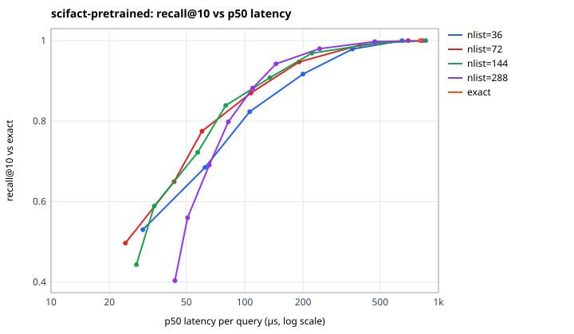

Concurrent searches against one shared read-only index:

| strategy | nprobe | goroutines | QPS | speed-up vs 1 | p50 | p99 |
|---|---|---|---|---|---|---|
| exact |  | 1 | 1,235 | 1.00× | 760 µs | 1.32 ms |
| exact |  | 2 | 2,087 | 1.69× | 948 µs | 1.58 ms |
| exact |  | 4 | 3,784 | 3.06× | 1.07 ms | 1.56 ms |
| exact |  | 6 | 4,833 | 3.91× | 1.22 ms | 2.25 ms |
| exact |  | 8 | 5,804 | 4.70× | 1.28 ms | 2.62 ms |
| exact |  | 12 | 6,157 | 4.98× | 1.36 ms | 11.15 ms |
| ivf | 32 | 1 | 2,466 | 1.00× | 380 µs | 743 µs |
| ivf | 32 | 2 | 4,231 | 1.72× | 450 µs | 844 µs |
| ivf | 32 | 4 | 7,166 | 2.91× | 550 µs | 992 µs |
| ivf | 32 | 6 | 9,159 | 3.71× | 614 µs | 1.43 ms |
| ivf | 32 | 8 | 10,494 | 4.26× | 667 µs | 2.35 ms |
| ivf | 32 | 12 | 10,436 | 4.23× | 680 µs | 9.28 ms |

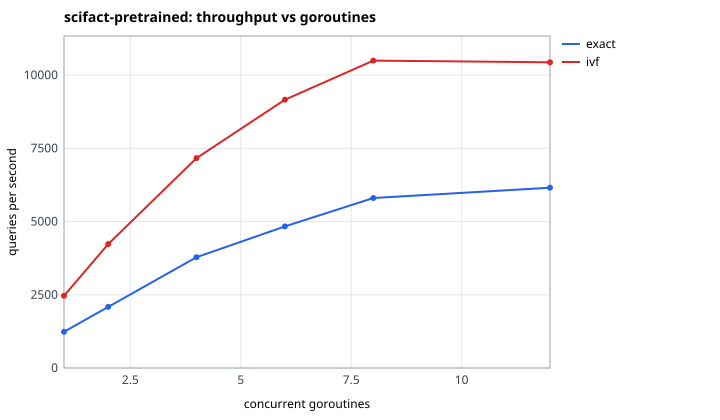

### scifact-finetuned-hardneg

5,183 vectors × 384 dims, 300 queries, kind `real`, from `vectorforge/ml/artifacts/scifact/finetuned-hardneg/export`.

| exact search | p50 | p95 | p99 | QPS (1 goroutine) | index memory (est.) |
|---|---|---|---|---|---|
| flat scan | 708 µs | 971 µs | 1.09 ms | 1,361 | 9.3 MB |

Fastest IVF operating point reaching each recall@10 target (nlist / nprobe):

| target | nlist / nprobe | recall@10 | p50 | p99 | vectors scored | p50 speed-up vs exact |
|---|---|---|---|---|---|---|
| ≥ 0.90 | 144 / 16 | 0.909 | 100 µs | 185 µs | 11.5 % | 7.1× |
| ≥ 0.95 | 144 / 32 | 0.963 | 166 µs | 511 µs | 22.4 % | 4.3× |
| ≥ 0.99 | 144 / 64 | 0.990 | 301 µs | 588 µs | 44.0 % | 2.4× |

IVF builds:

| nlist | build | k-means iterations | converged | mean cos to centroid | list size min / mean / max | imbalance | memory (est.) |
|---|---|---|---|---|---|---|---|
| 36 | 0.2 s | 17 | yes | 0.499 | 66 / 144 / 246 | 1.11 | 9.3 MB |
| 72 | 0.3 s | 21 | yes | 0.548 | 23 / 72 / 167 | 1.15 | 9.5 MB |
| 144 | 0.6 s | 22 | yes | 0.596 | 7 / 36 / 80 | 1.18 | 9.6 MB |
| 288 | 0.8 s | 13 | yes | 0.645 | 2 / 18 / 44 | 1.21 | 10.0 MB |

All operating points

| nlist | nprobe | recall@1 | recall@10 | recall@100 | p50 | p95 | p99 | QPS | vectors scored |
|---|---|---|---|---|---|---|---|---|---|
| 36 | 1 | 0.617 | 0.553 | 0.394 | 29 µs | 46 µs | 84 µs | 31,885 | 3.2 % |
| 36 | 2 | 0.753 | 0.705 | 0.554 | 50 µs | 81 µs | 142 µs | 18,585 | 6.2 % |
| 36 | 4 | 0.877 | 0.837 | 0.716 | 83 µs | 162 µs | 224 µs | 10,617 | 11.9 % |
| 36 | 8 | 0.943 | 0.919 | 0.859 | 175 µs | 270 µs | 349 µs | 5,405 | 22.9 % |
| 36 | 16 | 0.993 | 0.976 | 0.955 | 298 µs | 455 µs | 628 µs | 3,059 | 44.9 % |
| 36 | 32 | 1.000 | 1.000 | 0.999 | 605 µs | 852 µs | 942 µs | 1,561 | 89.1 % |
| 72 | 1 | 0.583 | 0.489 | 0.306 | 26 µs | 43 µs | 45 µs | 37,006 | 1.7 % |
| 72 | 2 | 0.757 | 0.640 | 0.459 | 34 µs | 52 µs | 66 µs | 28,312 | 3.3 % |
| 72 | 4 | 0.857 | 0.776 | 0.618 | 61 µs | 100 µs | 122 µs | 15,577 | 6.3 % |
| 72 | 8 | 0.920 | 0.874 | 0.768 | 89 µs | 143 µs | 177 µs | 10,344 | 12.1 % |
| 72 | 16 | 0.977 | 0.942 | 0.886 | 166 µs | 251 µs | 340 µs | 5,514 | 23.2 % |
| 72 | 32 | 0.997 | 0.985 | 0.966 | 309 µs | 479 µs | 621 µs | 2,930 | 45.0 % |
| 72 | 64 | 1.000 | 1.000 | 0.999 | 574 µs | 844 µs | 1.01 ms | 1,598 | 89.0 % |
| 144 | 1 | 0.590 | 0.469 | 0.218 | 22 µs | 39 µs | 47 µs | 40,043 | 0.8 % |
| 144 | 2 | 0.690 | 0.610 | 0.351 | 30 µs | 48 µs | 66 µs | 30,052 | 1.6 % |
| 144 | 4 | 0.810 | 0.732 | 0.505 | 38 µs | 59 µs | 127 µs | 23,381 | 3.1 % |
| 144 | 8 | 0.877 | 0.831 | 0.657 | 64 µs | 106 µs | 169 µs | 14,467 | 6.0 % |
| 144 | 16 | 0.940 | 0.909 | 0.799 | 100 µs | 142 µs | 185 µs | 9,516 | 11.5 % |
| 144 | 32 | 0.973 | 0.963 | 0.912 | 166 µs | 262 µs | 511 µs | 5,378 | 22.4 % |
| 144 | 64 | 1.000 | 0.990 | 0.977 | 301 µs | 468 µs | 588 µs | 2,989 | 44.0 % |
| 144 | 128 | 1.000 | 0.999 | 1.000 | 594 µs | 910 µs | 1.07 ms | 1,532 | 88.4 % |
| 288 | 1 | 0.563 | 0.412 | 0.138 | 47 µs | 64 µs | 142 µs | 20,849 | 0.4 % |
| 288 | 2 | 0.717 | 0.559 | 0.239 | 43 µs | 63 µs | 98 µs | 21,178 | 0.8 % |
| 288 | 4 | 0.847 | 0.700 | 0.377 | 45 µs | 70 µs | 80 µs | 19,737 | 1.5 % |
| 288 | 8 | 0.900 | 0.809 | 0.539 | 61 µs | 85 µs | 99 µs | 15,758 | 3.0 % |
| 288 | 16 | 0.940 | 0.878 | 0.700 | 71 µs | 100 µs | 183 µs | 12,640 | 5.9 % |
| 288 | 32 | 0.953 | 0.935 | 0.840 | 116 µs | 190 µs | 312 µs | 7,731 | 11.5 % |
| 288 | 64 | 0.987 | 0.980 | 0.939 | 188 µs | 285 µs | 389 µs | 4,823 | 22.5 % |
| 288 | 128 | 0.997 | 0.994 | 0.987 | 365 µs | 549 µs | 695 µs | 2,529 | 44.4 % |
| 288 | 256 | 1.000 | 1.000 | 1.000 | 664 µs | 951 µs | 1.12 ms | 1,405 | 88.7 % |

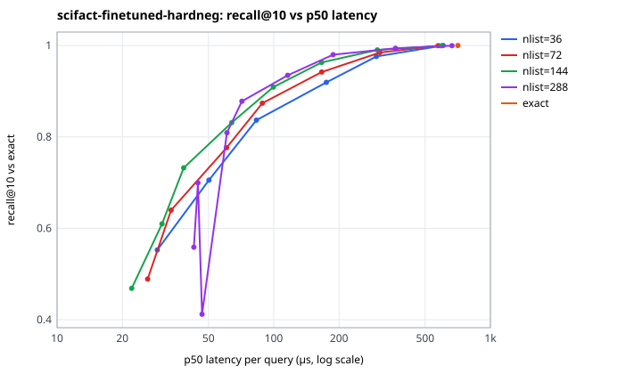

Concurrent searches against one shared read-only index:

| strategy | nprobe | goroutines | QPS | speed-up vs 1 | p50 | p99 |
|---|---|---|---|---|---|---|
| exact |  | 1 | 1,376 | 1.00× | 647 µs | 2.00 ms |
| exact |  | 2 | 2,473 | 1.80× | 787 µs | 1.27 ms |
| exact |  | 4 | 4,312 | 3.13× | 936 µs | 1.42 ms |
| exact |  | 6 | 5,400 | 3.92× | 1.12 ms | 1.92 ms |
| exact |  | 8 | 6,515 | 4.73× | 1.18 ms | 2.58 ms |
| exact |  | 12 | 7,202 | 5.23× | 1.20 ms | 11.30 ms |
| ivf | 32 | 1 | 3,059 | 1.00× | 299 µs | 576 µs |
| ivf | 32 | 2 | 5,129 | 1.68× | 373 µs | 710 µs |
| ivf | 32 | 4 | 8,119 | 2.65× | 475 µs | 1.08 ms |
| ivf | 32 | 6 | 10,516 | 3.44× | 533 µs | 1.49 ms |
| ivf | 32 | 8 | 12,025 | 3.93× | 564 µs | 2.30 ms |
| ivf | 32 | 12 | 13,846 | 4.53× | 577 µs | 6.79 ms |

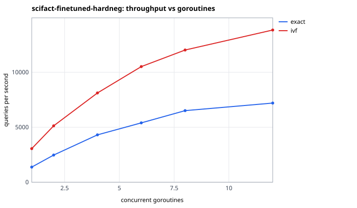

### quora-pretrained

522,931 vectors × 384 dims, 1000 queries, kind `real`, from `vectorforge/ml/artifacts/quora/pretrained/export`.

| exact search | p50 | p95 | p99 | QPS (1 goroutine) | index memory (est.) |
|---|---|---|---|---|---|
| flat scan | 87.20 ms | 98.57 ms | 133 ms | 11 | 1012.3 MB |

Fastest IVF operating point reaching each recall@10 target (nlist / nprobe):

| target | nlist / nprobe | recall@10 | p50 | p99 | vectors scored | p50 speed-up vs exact |
|---|---|---|---|---|---|---|
| ≥ 0.90 | 1446 / 8 | 0.909 | 804 µs | 1.34 ms | 0.6 % | 108.5× |
| ≥ 0.95 | 1446 / 32 | 0.964 | 2.37 ms | 3.52 ms | 2.4 % | 36.7× |
| ≥ 0.99 | 723 / 128 | 0.993 | 16.31 ms | 21.50 ms | 18.4 % | 5.3× |

IVF builds:

| nlist | build | k-means iterations | converged | mean cos to centroid | list size min / mean / max | imbalance | memory (est.) |
|---|---|---|---|---|---|---|---|
| 361 | 38.6 s | 25 | no | 0.557 | 327 / 1449 / 3718 | 1.13 | 920.3 MB |
| 723 | 133.9 s | 25 | no | 0.594 | 66 / 723 / 2149 | 1.15 | 929.3 MB |
| 1446 | 526.8 s | 25 | no | 0.629 | 46 / 362 / 1322 | 1.18 | 930.8 MB |

All operating points

| nlist | nprobe | recall@1 | recall@10 | recall@100 | p50 | p95 | p99 | QPS | vectors scored |
|---|---|---|---|---|---|---|---|---|---|
| 361 | 1 | 0.814 | 0.643 | 0.532 | 366 µs | 726 µs | 940 µs | 2,498 | 0.3 % |
| 361 | 2 | 0.920 | 0.784 | 0.671 | 624 µs | 1.08 ms | 1.38 ms | 1,521 | 0.6 % |
| 361 | 4 | 0.970 | 0.875 | 0.783 | 1.11 ms | 1.71 ms | 1.95 ms | 870 | 1.2 % |
| 361 | 8 | 0.986 | 0.924 | 0.859 | 2.12 ms | 3.02 ms | 3.49 ms | 459 | 2.4 % |
| 361 | 16 | 0.997 | 0.961 | 0.915 | 4.18 ms | 5.38 ms | 6.09 ms | 235 | 4.8 % |
| 361 | 32 | 0.998 | 0.980 | 0.952 | 8.25 ms | 10.26 ms | 11.77 ms | 120 | 9.4 % |
| 361 | 64 | 0.999 | 0.991 | 0.977 | 16.36 ms | 19.40 ms | 21.03 ms | 61 | 18.5 % |
| 361 | 128 | 0.999 | 0.997 | 0.992 | 31.62 ms | 35.62 ms | 38.14 ms | 32 | 36.4 % |
| 361 | 256 | 0.999 | 0.999 | 0.999 | 62.37 ms | 69.33 ms | 81.50 ms | 16 | 71.6 % |
| 723 | 1 | 0.823 | 0.655 | 0.521 | 258 µs | 436 µs | 580 µs | 3,632 | 0.2 % |
| 723 | 2 | 0.924 | 0.773 | 0.658 | 454 µs | 773 µs | 1.04 ms | 2,050 | 0.3 % |
| 723 | 4 | 0.969 | 0.863 | 0.768 | 656 µs | 1.02 ms | 1.25 ms | 1,435 | 0.6 % |
| 723 | 8 | 0.989 | 0.914 | 0.841 | 1.18 ms | 1.70 ms | 1.97 ms | 824 | 1.2 % |
| 723 | 16 | 0.995 | 0.949 | 0.897 | 2.21 ms | 3.02 ms | 3.42 ms | 443 | 2.4 % |
| 723 | 32 | 0.997 | 0.971 | 0.938 | 4.27 ms | 5.43 ms | 5.91 ms | 232 | 4.7 % |
| 723 | 64 | 0.999 | 0.985 | 0.966 | 8.14 ms | 9.84 ms | 10.98 ms | 121 | 9.3 % |
| 723 | 128 | 1.000 | 0.993 | 0.983 | 16.31 ms | 19.42 ms | 21.50 ms | 61 | 18.4 % |
| 723 | 256 | 1.000 | 0.997 | 0.994 | 30.88 ms | 34.45 ms | 36.12 ms | 32 | 36.3 % |
| 1446 | 1 | 0.798 | 0.633 | 0.498 | 345 µs | 532 µs | 800 µs | 2,746 | 0.1 % |
| 1446 | 2 | 0.914 | 0.772 | 0.643 | 478 µs | 802 µs | 1.26 ms | 1,949 | 0.2 % |
| 1446 | 4 | 0.966 | 0.859 | 0.747 | 622 µs | 923 µs | 1.12 ms | 1,553 | 0.3 % |
| 1446 | 8 | 0.981 | 0.909 | 0.827 | 804 µs | 1.16 ms | 1.34 ms | 1,204 | 0.6 % |
| 1446 | 16 | 0.993 | 0.939 | 0.883 | 1.36 ms | 2.06 ms | 2.44 ms | 706 | 1.2 % |
| 1446 | 32 | 0.995 | 0.964 | 0.925 | 2.37 ms | 3.18 ms | 3.52 ms | 415 | 2.4 % |
| 1446 | 64 | 0.998 | 0.978 | 0.955 | 4.92 ms | 6.41 ms | 6.97 ms | 201 | 4.8 % |
| 1446 | 128 | 0.998 | 0.988 | 0.976 | 8.30 ms | 10.28 ms | 11.30 ms | 119 | 9.4 % |
| 1446 | 256 | 0.998 | 0.994 | 0.989 | 16.62 ms | 19.44 ms | 20.89 ms | 60 | 18.5 % |

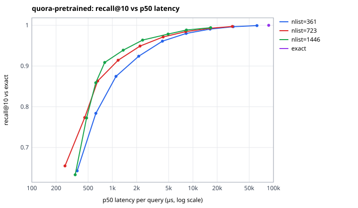

Concurrent searches against one shared read-only index:

| strategy | nprobe | goroutines | QPS | speed-up vs 1 | p50 | p99 |
|---|---|---|---|---|---|---|
| exact |  | 1 | 11 | 1.00× | 86.84 ms | 108 ms |
| exact |  | 2 | 19 | 1.71× | 102 ms | 120 ms |
| exact |  | 4 | 32 | 2.83× | 122 ms | 184 ms |
| exact |  | 6 | 38 | 3.29× | 156 ms | 242 ms |
| exact |  | 8 | 41 | 3.55× | 196 ms | 237 ms |
| exact |  | 12 | 41 | 3.60× | 285 ms | 408 ms |
| ivf | 32 | 1 | 238 | 1.00× | 4.16 ms | 5.74 ms |
| ivf | 32 | 2 | 401 | 1.69× | 4.94 ms | 7.00 ms |
| ivf | 32 | 4 | 691 | 2.91× | 5.78 ms | 7.73 ms |
| ivf | 32 | 6 | 821 | 3.45× | 7.24 ms | 10.32 ms |
| ivf | 32 | 8 | 808 | 3.40× | 9.16 ms | 24.81 ms |
| ivf | 32 | 12 | 824 | 3.47× | 11.14 ms | 57.32 ms |

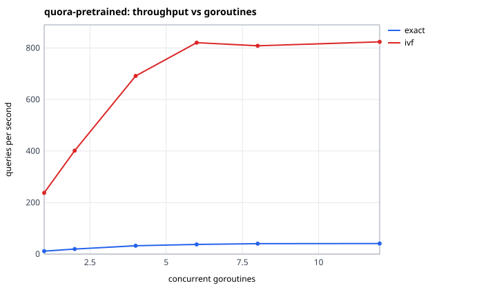

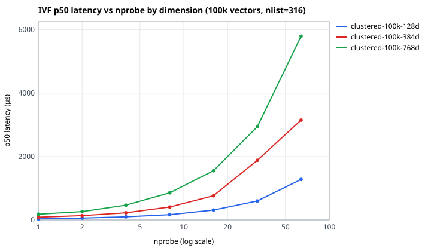

## storage

`storage` suite — AMD Ryzen 5 5600 6-Core Processor, go1.26.0, GOMAXPROCS=12, commit `b5ebf7d` (dirty), timer QueryPerformanceCounter, wall 1.3 min, started 2026-10-18T01:29:24Z

100,000 vectors × 384 dims in a fresh byodb file (1000 vectors per transaction).

| measurement | value |
|---|---|
| bulk insert | 36.1 s (2,773 vectors/s) |
| single-chunk upsert (one commit each) | p50 1.92 ms, p99 2.76 ms (n=50) |
| file size | 347.5 MB (3,474 bytes/vector; raw float32 = 153.6 MB) |
| pages | 84,845 total, 8 free |
| IVF train (nlist=316) | 10.8 s |
| IVF persist (centroids + postings, one transaction) | 24.30 s |
| cold open (read-only) | 8.3 ms |
| cold load: stream all vectors into the flat index | 1.54 s |
| cold load: rebuild IVF lists from persisted postings | 0.20 s |
| reloaded IVF returns identical results | yes (200 queries) |

| table | rows |
|---|---|
| vf_chunks | 100,050 |
| vf_documents | 1,050 |
| vf_ingest_runs | 0 |
| vf_ivf_centroids | 632 |
| vf_ivf_postings | 100,050 |
| vf_meta | 4 |
| vf_vectors | 200,100 |

## ANN recall vs relevance (real embeddings, BEIR labels)

### quora / pretrained

1000 test queries, 522,931 documents.

| strategy | nlist | nprobe | ANN recall@10 | nDCG@10 | MRR@10 | Recall@10 | Recall@100 | Δ nDCG@10 vs exact [95 % CI] |
|---|---|---|---|---|---|---|---|---|
| exact |  |  | 1.000 | 0.8739 | 0.8680 | 0.9554 | 0.9957 |  |
| ivf | 723 | 1 | 0.655 | 0.7172 | 0.7240 | 0.7739 | 0.7989 | -0.1568 [-0.1790, -0.1353] |
| ivf | 723 | 2 | 0.773 | 0.8020 | 0.8059 | 0.8677 | 0.8973 | -0.0719 [-0.0873, -0.0567] |
| ivf | 723 | 4 | 0.863 | 0.8428 | 0.8424 | 0.9155 | 0.9516 | -0.0311 [-0.0415, -0.0216] |
| ivf | 723 | 8 | 0.914 | 0.8600 | 0.8585 | 0.9348 | 0.9739 | -0.0139 [-0.0203, -0.0082] |
| ivf | 723 | 16 | 0.949 | 0.8664 | 0.8625 | 0.9430 | 0.9829 | -0.0075 [-0.0124, -0.0033] |
| ivf | 723 | 32 | 0.971 | 0.8699 | 0.8651 | 0.9495 | 0.9894 | -0.0040 [-0.0078, -0.0010] |
| ivf | 723 | 64 | 0.985 | 0.8724 | 0.8670 | 0.9537 | 0.9941 | -0.0015 [-0.0041, +0.0001] |
| ivf | 723 | 128 | 0.993 | 0.8734 | 0.8680 | 0.9547 | 0.9950 | -0.0005 [-0.0016, +0.0000] |
| ivf | 723 | 256 | 0.997 | 0.8739 | 0.8680 | 0.9554 | 0.9957 | +0.0000 [+0.0000, +0.0000] |
| BM25 |  |  |  | 0.7097 | 0.7009 | 0.8195 | 0.9407 |  |

Exact dense − BM25: Δ nDCG@10 +0.1642, 95 % CI [+0.1441, +0.1848], 396 improved / 88 worsened / 516 unchanged.

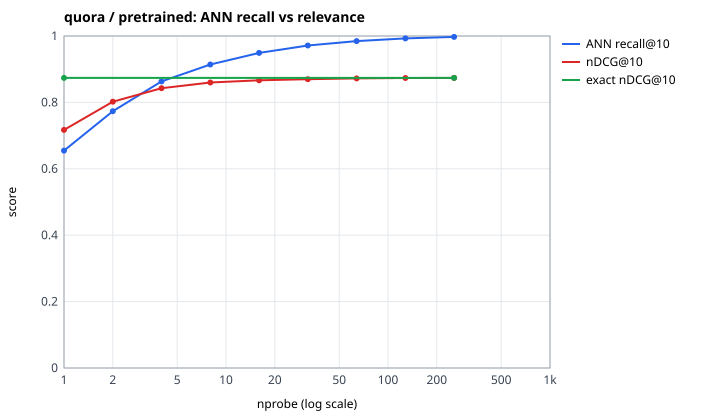

### scifact / finetuned-hardneg

300 test queries, 5,183 documents.

| strategy | nlist | nprobe | ANN recall@10 | nDCG@10 | MRR@10 | Recall@10 | Recall@100 | Δ nDCG@10 vs exact [95 % CI] |
|---|---|---|---|---|---|---|---|---|
| exact |  |  | 1.000 | 0.6994 | 0.6520 | 0.8600 | 0.9533 |  |
| ivf | 72 | 1 | 0.489 | 0.4255 | 0.4042 | 0.5036 | 0.5356 | -0.2738 [-0.3225, -0.2256] |
| ivf | 72 | 2 | 0.640 | 0.5374 | 0.5063 | 0.6463 | 0.6967 | -0.1619 [-0.2040, -0.1219] |
| ivf | 72 | 4 | 0.776 | 0.5895 | 0.5564 | 0.7060 | 0.7737 | -0.1099 [-0.1433, -0.0784] |
| ivf | 72 | 8 | 0.874 | 0.6345 | 0.5974 | 0.7643 | 0.8470 | -0.0649 [-0.0908, -0.0411] |
| ivf | 72 | 16 | 0.942 | 0.6692 | 0.6276 | 0.8127 | 0.8987 | -0.0302 [-0.0480, -0.0148] |
| ivf | 72 | 32 | 0.985 | 0.6908 | 0.6451 | 0.8467 | 0.9333 | -0.0086 [-0.0188, -0.0005] |
| ivf | 72 | 64 | 1.000 | 0.6979 | 0.6512 | 0.8567 | 0.9500 | -0.0014 [-0.0043, +0.0000] |
| BM25 |  |  |  | 0.6608 | 0.6300 | 0.7784 | 0.8859 |  |

Exact dense − BM25: Δ nDCG@10 +0.0385, 95 % CI [+0.0009, +0.0771], 85 improved / 53 worsened / 162 unchanged.

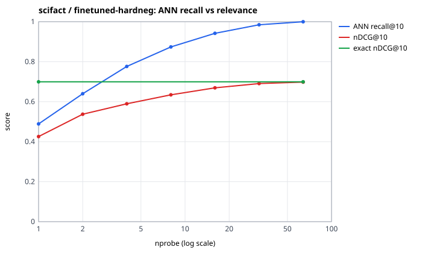

### scifact / pretrained

300 test queries, 5,183 documents.

| strategy | nlist | nprobe | ANN recall@10 | nDCG@10 | MRR@10 | Recall@10 | Recall@100 | Δ nDCG@10 vs exact [95 % CI] |
|---|---|---|---|---|---|---|---|---|
| exact |  |  | 1.000 | 0.6451 | 0.6047 | 0.7833 | 0.9250 |  |
| ivf | 72 | 1 | 0.497 | 0.3966 | 0.3793 | 0.4663 | 0.5133 | -0.2485 [-0.2955, -0.2011] |
| ivf | 72 | 2 | 0.650 | 0.4809 | 0.4573 | 0.5686 | 0.6489 | -0.1642 [-0.2063, -0.1236] |
| ivf | 72 | 4 | 0.775 | 0.5543 | 0.5252 | 0.6596 | 0.7622 | -0.0907 [-0.1234, -0.0598] |
| ivf | 72 | 8 | 0.870 | 0.5955 | 0.5617 | 0.7172 | 0.8372 | -0.0496 [-0.0737, -0.0268] |
| ivf | 72 | 16 | 0.947 | 0.6155 | 0.5782 | 0.7450 | 0.8700 | -0.0296 [-0.0485, -0.0131] |
| ivf | 72 | 32 | 0.989 | 0.6430 | 0.6031 | 0.7800 | 0.9217 | -0.0020 [-0.0063, +0.0002] |
| ivf | 72 | 64 | 1.000 | 0.6451 | 0.6047 | 0.7833 | 0.9250 | +0.0000 [+0.0000, +0.0000] |
| BM25 |  |  |  | 0.6608 | 0.6300 | 0.7784 | 0.8859 |  |

Exact dense − BM25: Δ nDCG@10 -0.0157, 95 % CI [-0.0549, +0.0237], 67 improved / 73 worsened / 160 unchanged.

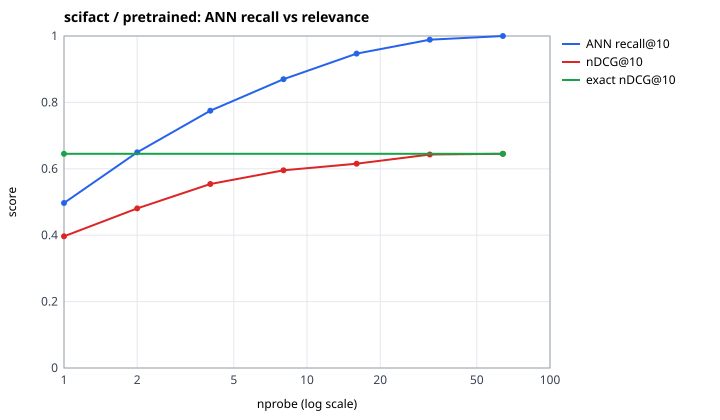

## HTTP API end to end

### run 1: embedding service with default torch threads (6) (2026-10-18T02:39:25Z)

44 queries × 5 repeats against a server holding 7,478 vectors (357 documents); model `sentence-transformers/all-MiniLM-L6-v2@1110a243fdf4`.

| strategy | nprobe | client p50 ms | client p99 ms | embed p50 ms | index search p50 ms | text fetch p50 ms | server total p50 ms |
|---|---|---|---|---|---|---|---|
| exact |  | 13.38 | 15.84 | 10.22 | 1.333 | 1.288 | 12.85 |
| ivf | 8 | 12.07 | 22.92 | 10.11 | 0.136 | 1.268 | 11.55 |

| strategy | clients | QPS | p50 ms | p99 ms | errors |
|---|---|---|---|---|---|
| exact | 1 | 71.1 | 13.4 | 19.4 | 0 |
| exact | 2 | 77.8 | 24.8 | 38.3 | 0 |
| exact | 4 | 53.5 | 56.8 | 643.0 | 0 |
| exact | 8 | 39.0 | 145.3 | 958.1 | 0 |
| ivf | 1 | 51.5 | 16.9 | 50.5 | 0 |
| ivf | 2 | 59.5 | 28.8 | 100.8 | 0 |
| ivf | 4 | 59.3 | 61.6 | 154.6 | 0 |
| ivf | 8 | 62.0 | 121.6 | 282.8 | 0 |

### embedding service with VF_TORCH_THREADS=4 (2026-10-18T02:41:37Z)

44 queries × 5 repeats against a server holding 7,478 vectors (357 documents); model `sentence-transformers/all-MiniLM-L6-v2@1110a243fdf4`.

| strategy | nprobe | client p50 ms | client p99 ms | embed p50 ms | index search p50 ms | text fetch p50 ms | server total p50 ms |
|---|---|---|---|---|---|---|---|
| exact |  | 14.90 | 20.14 | 11.64 | 1.333 | 1.337 | 14.35 |
| ivf | 8 | 13.41 | 33.98 | 11.40 | 0.135 | 1.284 | 12.89 |

| strategy | clients | QPS | p50 ms | p99 ms | errors |
|---|---|---|---|---|---|
| exact | 1 | 68.5 | 14.2 | 21.5 | 0 |
| exact | 2 | 80.8 | 23.5 | 52.9 | 0 |
| exact | 4 | 73.4 | 52.3 | 77.7 | 0 |
| exact | 8 | 68.4 | 112.4 | 146.7 | 0 |
| ivf | 1 | 74.9 | 12.9 | 18.2 | 0 |
| ivf | 2 | 81.2 | 24.3 | 31.8 | 0 |
| ivf | 4 | 64.2 | 55.6 | 116.7 | 0 |
| ivf | 8 | 63.6 | 118.6 | 161.7 | 0 |

### run 2: embedding service with default torch threads (6) (2026-10-18T02:43:17Z)

44 queries × 5 repeats against a server holding 7,478 vectors (357 documents); model `sentence-transformers/all-MiniLM-L6-v2@1110a243fdf4`.

| strategy | nprobe | client p50 ms | client p99 ms | embed p50 ms | index search p50 ms | text fetch p50 ms | server total p50 ms |
|---|---|---|---|---|---|---|---|
| exact |  | 16.37 | 39.48 | 12.73 | 1.512 | 1.501 | 15.82 |
| ivf | 8 | 15.51 | 31.07 | 13.03 | 0.152 | 1.502 | 14.79 |

| strategy | clients | QPS | p50 ms | p99 ms | errors |
|---|---|---|---|---|---|
| exact | 1 | 63.9 | 15.1 | 22.9 | 0 |
| exact | 2 | 70.5 | 27.3 | 44.5 | 0 |
| exact | 4 | 41.6 | 60.7 | 496.6 | 0 |
| exact | 8 | 60.4 | 130.1 | 168.1 | 0 |
| ivf | 1 | 63.9 | 15.3 | 20.9 | 0 |
| ivf | 2 | 63.3 | 30.2 | 54.1 | 0 |
| ivf | 4 | 54.1 | 67.9 | 128.8 | 0 |
| ivf | 8 | 52.7 | 139.9 | 229.0 | 0 |

