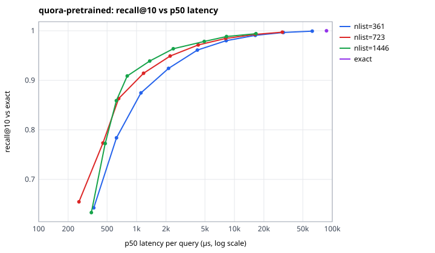
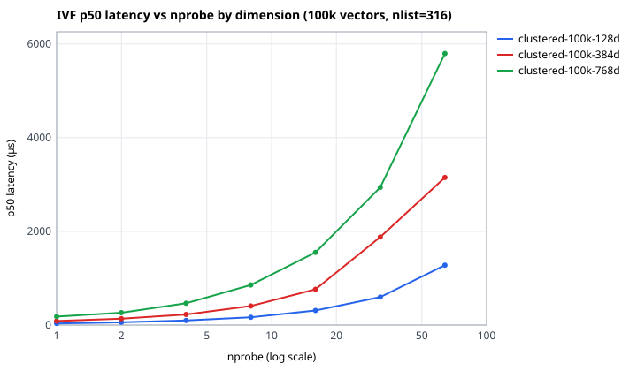
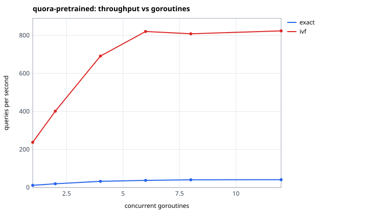
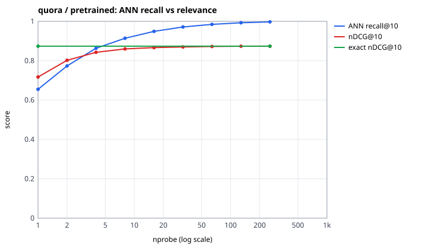

# VectorForge benchmarks

What exact and IVF search cost, how that changes with data size, dimension,
k, nlist, nprobe and concurrency, what persistence costs, and what a search
request costs end to end. Every number below comes from a JSON file in
`vectorforge/results/`; the complete tables (every operating point) and all
charts are generated from those files by `vectorforge/scripts/benchreport.py`
into [benchmark-tables.md](benchmark-tables.md). Relevance quality is covered
in [ml-methodology.md](ml-methodology.md).

## Headline results

| question | measured answer | source |
|---|---|---|
| exact search, 523k real 384-d vectors (Quora) | p50 87.2 ms, 11 QPS on one core | `bench/real.json` |
| IVF on the same 523k vectors, nlist 723 = √N | recall@10 0.949 at p50 2.21 ms (39× faster), scoring 2.4 % of vectors | `bench/real.json` |
| IVF, fastest setting found per recall target | ≥ 0.90: 0.80 ms (108×) · ≥ 0.95: 2.37 ms (37×) · ≥ 0.99: 16.3 ms (5.3×) | `bench/real.json` |
| relevance cost of IVF (nDCG@10 vs exact, BEIR labels) | −1.6 % at ANN recall 0.91 on Quora; within bootstrap noise of exact at ANN recall 0.985–0.99 except fine-tuned SciFact (−0.009 at 0.985) | `ml/ann-relevance.json` |
| cold start, 100k vectors from disk | 1.75 s (vectors 1.54 s + persisted IVF 0.20 s) vs 10.8 s to retrain k-means; identical results | `bench/storage.json` |
| one search through the HTTP API, 7,478 vectors | p50 13.4 ms, of which 10.2 ms is embedding the query | `bench/api.json` |
| crash/restart end-to-end check | 17 of 17 checks passed (process killed twice) | `e2e/e2e.json` |

## Environment and method

- **Machine.** AMD Ryzen 5 5600 (6 cores / 12 threads, 32 MB L3), 2 × 8 GB
  DDR4-3600 (57.6 GB/s theoretical), Windows 11, Go 1.26.0, GOMAXPROCS 12.
  A desktop with an IDE and browser open: absolute numbers carry run-to-run
  noise (the same 100k × 384 exact benchmark measured 13.49 ms and 14.13 ms
  p50 in two suites).
- **Code.** All `vfbench` suites ran the Go sources of commit `b5ebf7d`. The
  reports say `git_dirty: true` because uncommitted Python and documentation
  files were present; `git diff b5ebf7d -- '*.go'` is empty.
- **Timer.** Go's monotonic clock on Windows advances in ~0.5 ms steps, so
  latencies use a QueryPerformanceCounter clock (`vectorforge/hrtime`, 100 ns
  resolution). Each query is timed individually after 50 warm-up queries;
  percentiles are nearest-rank.
- **Scope.** Index benchmarks measure in-memory search only (scoring and
  top-k) on one goroutine unless stated. Embedding, HTTP and text fetches are
  excluded there and measured separately in the API benchmark.
- **Recall@k** (ANN recall) = |IVF top-k ∩ exact top-k| / k, averaged over
  queries, against exact search on the same vectors. It measures the index,
  not relevance.
- **QPS** (serial) = 1 / mean latency; concurrent QPS = queries completed /
  wall time with W goroutines sharing one read-only index.
- **Build time** = k-means (k-means++ seeding, ≤ 25 Lloyd iterations, sample
  of ≤ 256 vectors per list, seed 42) plus assigning every vector.
- **Memory** = an estimate from payload sizes, cross-checked against the live
  heap delta after GC (they agree within 2.5 % in every run).
- **Data.**
  - *Synthetic clustered*: Gaussian blobs around 1,000 random unit centres
    (expected cosine to centre ~0.71); queries are fresh draws, never
    dataset points. *Synthetic isotropic*: uniform random unit vectors.
  - *Real*: MiniLM embeddings exported by `vfml` — SciFact (5,183 abstracts,
    300 test queries; pretrained and fine-tuned models) and Quora (522,931
    questions, 1,000 test queries sampled with seed 2027).
- 1,000 queries per dataset unless the dataset has fewer.

## 1. Exact search

| dataset | vectors | dim | p50 | p99 | QPS | memory |
|---|---|---|---|---|---|---|
| SciFact (real) | 5,183 | 384 | 0.81 ms | 1.31 ms | 1,196 | 9.3 MB |
| clustered | 10,000 | 384 | 1.26 ms | 2.65 ms | 740 | 18.3 MB |
| clustered | 100,000 | 128 | 5.24 ms | 6.88 ms | 189 | 68.0 MB |
| clustered | 100,000 | 384 | 13.49 ms | 24.51 ms | 72 | 170.5 MB |
| clustered | 100,000 | 768 | 27.82 ms | 45.61 ms | 35 | 380.9 MB |
| clustered | 500,000 | 384 | 76.65 ms | 144 ms | 12 | 814.0 MB |
| Quora (real) | 522,931 | 384 | 87.20 ms | 133 ms | 11 | 1,012 MB |

Cost is linear in N·d, as it must be: 2.3–2.9 billion multiply-adds per
second on one core with a 4-way unrolled scalar loop (Go does not
auto-vectorize). Latency is almost independent of k (12.6–13.2 ms for k from
1 to 100 at 100k vectors) because selection is a bounded heap. Exact search
is the right choice below roughly 10k vectors: at SciFact's size it costs
0.8 ms, and IVF at ≥ 0.95 recall is only 3.6× faster.

## 2. IVF: the recall/latency trade-off

### The data decides how well IVF works



Fastest (nlist, nprobe) reaching each recall@10 target, from the full
sweeps (nlist ∈ {√N/2, √N, 2√N, 4√N}, nprobe 1–256):

| dataset | recall ≥ 0.90 | recall ≥ 0.95 | recall ≥ 0.99 |
|---|---|---|---|
| Quora, real, 523k | 1446/8: 0.80 ms, 0.6 % scored, 108× | 1446/32: 2.37 ms, 2.4 %, 37× | 723/128: 16.3 ms, 18.4 %, 5.3× |
| SciFact, real, 5k | 144/16: 0.14 ms, 12 %, 6.0× | 144/32: 0.22 ms, 24 %, 3.6× | 288/128: 0.47 ms, 48 %, 1.7× |
| clustered, 100k | 316/1: 0.08 ms, 0.4 %, 168× | same | same (recall 1.000) |
| clustered, 500k | 707/1: 0.31 ms, 0.2 %, 246× | same | same (recall 1.000) |
| isotropic, 100k | 316/256: 11.6 ms, 81 %, 1.3× | not reached | not reached |

("scored" = fraction of vectors whose similarity was computed; speed-up is
p50 vs exact on the same data.)

The synthetic datasets bracket reality. With 1,000 tight clusters and ~100
points per cluster, a query's ten nearest neighbours almost always share its
cluster, so one probe finds them all: clustered data is IVF's **best case**.
Uniform random vectors have no cluster structure at all, so a query's
neighbours are spread over every list: isotropic data is the **worst case**,
where IVF needs 81 % of the work of exact search for 0.94 recall. Real
embeddings sit in between, which is why every recall claim in this project
is made on real embeddings. Even between real datasets the cost differs:
SciFact needs a quarter of its corpus scored for 0.95 recall, Quora 2.4 %;
small corpora have few points per list and short asymmetric queries.

### Choosing nlist

- **Probe cost vs list cost.** Each query scores all nlist centroids before
  scanning any list. At 100k vectors with nlist 1,264, one probe took 219 µs
  although it scanned only ~80 vectors; with nlist 316 it took 80 µs. Too
  many lists makes the coarse step dominate; too few makes each probe scan a
  large slice. The default round(√N) balances the two terms of
  \(\text{nlist}\cdot d + \frac{\text{nprobe}}{\text{nlist}}N d\).
- **On Quora, more lists won at every latency, by a shrinking margin.** At
  matched p50, nlist 1,446 vs 723 gave recall 0.964 vs 0.949 (~2.3 ms),
  0.978 vs 0.971 (~4.5 ms), 0.988 vs 0.985 (~8.2 ms) and 0.994 vs 0.993
  (~16.5 ms); nlist 361 was worst throughout. The win cost 4× the build time.
- **Build cost grows quickly with nlist.** The training sample is
  256 × nlist vectors and each Lloyd iteration scores every sample against
  every centroid, so cost grows with nlist²: Quora took 38.6 s (361 lists),
  134 s (723) and 527 s (1,446). None of the three converged within 25
  iterations (tolerance 1e-4); IVF only needs approximate centroids, and the
  recall table is measured with these centroids.
- **Balance.** List-size imbalance factors (nlist·Σnᵢ²/N², 1.0 = perfectly
  even) were 1.0–1.3 throughout; no build produced empty lists.

### k

At 100k clustered vectors and nlist 316 / nprobe 1, raising k from 1 to 100
moved IVF p50 from 87 µs to 96 µs, but recall@100 fell to 0.962: a single
list holds about 316 vectors, so the 100 true neighbours are no longer all in
it. Larger k needs proportionally more probes.

### Dimension

At 100k clustered vectors, exact p50 was 5.24 / 14.13 / 27.82 ms for 128 /
384 / 768 dimensions (5.3× for 6× the dimension), and IVF at one probe
34 / 88 / 180 µs; memory 68 / 171 / 381 MB.



### Fine-tuned vectors

The fine-tuned SciFact model spreads documents further from their centroids
(mean cosine to centroid 0.548 vs 0.620 at nlist 72, consistent with
contrastive training pushing documents apart), yet IVF approximates both
models equally well (recall@10 at nlist 72 / nprobe 8: 0.874 vs 0.870).

## 3. Concurrency

Searches share one read-only index; each goroutine runs queries from a
shared counter. The bandwidth column is derived, not separately measured:
QPS × vectors scored per query × 384 × 4 bytes.

| workload | vector data | 1 goroutine | best | speed-up | implied vector reads |
|---|---|---|---|---|---|
| exact, 100k clustered | 154 MB | 65 QPS | 194 QPS (8) | 2.96× | 29.8 GB/s |
| exact, Quora 523k | 803 MB | 11.4 QPS | 41.1 QPS (12) | 3.60× | 33.0 GB/s |
| IVF nprobe 32, Quora | ~38 MB per query | 238 QPS | 824 QPS (12) | 3.47× | 31.1 GB/s |
| IVF nprobe 1, 100k clustered | ~0.6 MB per query | 8,519 QPS | 49,948 QPS (12) | 5.86× | 27.0 GB/s |
| exact, SciFact 5k | 8 MB | 1,235 QPS | 6,157 QPS (12) | 4.98× | 49.0 GB/s |



Three different workloads whose data is larger than the 32 MB L3 cache
plateau at the same 30–33 GB/s of vector reads, about 55 % of the memory
system's theoretical peak, while SciFact, whose 8 MB fits in cache, reaches
49 GB/s — more than DRAM could deliver. One core reads ~10 GB/s through the
scalar dot-product loop. The reading: single-threaded search is compute-bound
and would benefit from SIMD, but multi-threaded search over large collections
is memory-bandwidth-bound at about three cores' worth of work, so the lever
there is fewer bytes per vector (int8 or fp16 quantization), not faster
arithmetic. That is an inference from these measurements, not a separate
memory benchmark.

## 4. Storage and persistence

100,000 synthetic 384-d vectors written to a fresh byodb file, 1,000 vectors
per transaction, then closed, reopened read-only and loaded
(`bench/storage.json`):

| measurement | value |
|---|---|
| bulk insert | 36.1 s, 2,773 vectors/s |
| single-chunk upsert, one commit each | p50 1.92 ms, p99 2.76 ms (fsync-bound) |
| file size | 347.5 MB = 3,474 bytes/vector (raw float32: 1,536) |
| IVF training (nlist 316) | 10.8 s |
| IVF persist (316 centroids + 100k postings, one transaction) | 24.3 s |
| cold open | 8.3 ms |
| cold load: all vectors into the exact index | 1.54 s |
| cold load: IVF lists from persisted postings | 0.20 s |
| reloaded IVF returns identical results | yes, 200 of 200 queries |

Loading the persisted index is 53× faster than retraining it, and the
reloaded index returns the same results, so "persistent" means persistent.
Two costs stand out. The file is 2.26× the raw vector payload (B+tree page
fill, chunk and posting rows, secondary indexes, escaped segments). And
writing the IVF state took longer than training it; that path has not been
profiled (see [architecture.md](architecture.md#known-limitations)).

## 5. ANN recall versus relevance

ANN recall says how faithfully IVF reproduces exact search; it does not say
whether results are relevant. Scoring the same IVF runs against BEIR labels
(`ml/ann-relevance.json`):



- Quora, nprobe 8: ANN recall@10 0.914 but nDCG@10 only 1.6 % below exact
  (0.860 vs 0.874).
- SciFact, nprobe 16: ANN recall@10 0.947, nDCG@10 4.6 % below exact
  (0.616 vs 0.645). Relevance loss is closer to proportional here.
- The 95 % bootstrap interval of the nDCG@10 difference first included zero
  at ANN recall 0.985 on Quora (nprobe 64) and 0.989 on pretrained SciFact
  (nprobe 32); the fine-tuned SciFact model at ANN recall 0.985 was still
  measurably below exact (−0.009, CI [−0.019, −0.0005]).
- On the 44-query code-search set, IVF at nprobe 8 scored *above* exact
  search (0.825 vs 0.810, within noise), which can only happen because ANN
  recall and relevance are different quantities.

Details and confidence intervals: [ml-methodology.md §7–8](ml-methodology.md#7-code-search-on-the-demo-corpus).

## 6. End to end through the HTTP API

`vectorforge/scripts/apibench.py` sent the 44 evaluation queries × 5 repeats
to `POST /api/v1/search` (top-10) on the demo server (7,478 vectors, nlist
86), with the embedding service on the same CPU. Server-side timings come
from the response's own breakdown.

| strategy | client p50 | embed p50 | index search p50 | text fetch p50 |
|---|---|---|---|---|
| exact | 13.38 ms | 10.22 ms | 1.33 ms | 1.29 ms |
| IVF (nprobe 8) | 12.07 ms | 10.11 ms | 0.14 ms | 1.27 ms |

(run 1, `bench/api.json`; a second run measured 16.4 / 15.5 ms client p50
with 12.7 / 13.0 ms embedding — machine state matters at this scale.)

At demo scale, query embedding is three quarters of the request. IVF cuts
index time 10× but the request only 10 %. The index matters at hundreds of
thousands of vectors, where exact search is 80+ ms.

**Under concurrent clients**, throughput stayed between 39 and 81 QPS in
every run, i.e. close to 1 / (embedding time): the embedding service runs
one CPU model and serializes calls. Tail latency was the unstable part:

| configuration | exact, 4 clients | exact, 8 clients | IVF, 8 clients |
|---|---|---|---|
| run 1, torch default threads (6) | 53.5 QPS, p99 643 ms | 39.0 QPS, p99 958 ms | 62.0 QPS, p99 283 ms |
| run 2, torch default threads (6) | 41.6 QPS, p99 497 ms | 60.4 QPS, p99 168 ms | 52.7 QPS, p99 229 ms |
| `VF_TORCH_THREADS=4` (one run) | 73.4 QPS, p99 78 ms | 68.4 QPS, p99 147 ms | 63.6 QPS, p99 162 ms |

The intermittent half-second-plus tails with six torch threads, and their
absence with four, are consistent with CPU contention between PyTorch's
worker threads and the Go server on the same six cores, but three runs are
not enough to call it settled. The production answers are known: run the
model on its own cores or a GPU, and batch concurrent queries into one
forward pass.

## 7. What these numbers do not show

- **No FAISS reference.** The brief allowed FAISS as an external comparison;
  it was not run, so there is no claim about how this IVF compares with an
  optimized library (it certainly lacks SIMD and quantization).
- **One run per index configuration.** p50s are stable; p99s on a desktop
  are noisy, so isolated p99 spikes in the full tables should not be read as
  structural.
- **Synthetic data is not a workload.** It is used for scaling behaviour
  (size, dimension, k, concurrency), not for recall claims.
- **Quora queries are a 1,000-query sample** of the 10,000 test queries; the
  sample seed and IDs are in the export metadata.
- **No HNSW, no filters in the index benchmarks**, and the API benchmark
  covers one small corpus.

## Reproducing

```sh
go build -o vfbench ./cmd/vfbench
./vfbench -suite synthetic          # 17 min on the machine above
./vfbench -suite dims               # 2 min
./vfbench -suite storage            # 1.3 min
cd vectorforge/ml
.venv/bin/python -m vfml.scifact    # writes the SciFact exports (44 min)
.venv/bin/python -m vfml.export quora --queries 1000   # 29 min
cd ../..
A=vectorforge/ml/artifacts
./vfbench -suite real -real $A/scifact/pretrained/export,$A/scifact/finetuned-hardneg/export,$A/quora/pretrained/export   # 31 min
(cd vectorforge/ml && .venv/bin/python -m vfml.annrelevance ../results/bench/runs --out ../results/ml --bm25)
python vectorforge/scripts/apibench.py --label "..."   # needs the server and embedding service running
python vectorforge/scripts/benchreport.py
```

Run benchmarks on an otherwise idle machine; the numbers above were taken
with nothing else CPU-heavy running.
