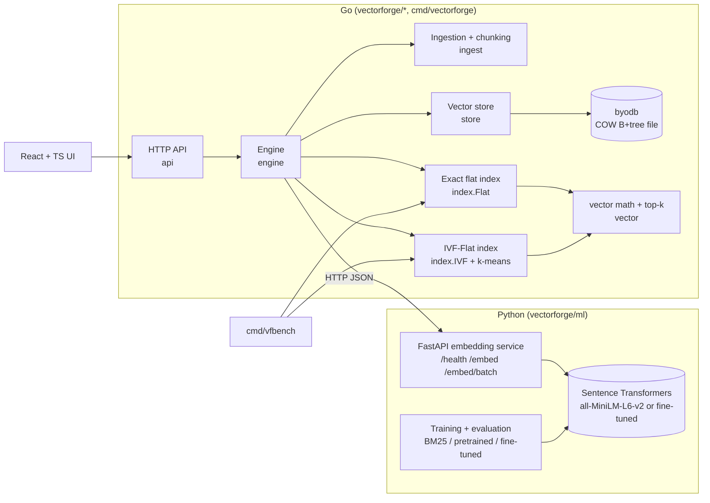

# VectorForge design

VectorForge is a semantic search engine built inside this repository on top
of the byodb storage engine. Text and source code are split into chunks,
embedded by a local Sentence Transformers model, and stored as rows in the
same copy-on-write B+tree database used by the market service. Exact and
IVF-Flat approximate nearest-neighbour search are implemented in Go.

This note records the repository audit and the decisions that follow from it.
`architecture.md` explains the finished implementation in more depth.

## 1. Audit findings that shape the design

| Finding (from reading the code) | Consequence |
| --- | --- |
| Durability is shadow paging: COW pages are written and fsynced, then one of two checksummed meta pages is published and fsynced (`pager.go`). There is no separate WAL file. | A VectorForge transaction is durable at the meta-page fsync. A crash exposes the old or the new root, never a partial transaction. |
| `DBTX` gives snapshot reads plus atomic multi-table, multi-row commits; conflicts return `ErrConflict` (`kv.go`, `table.go`). | Document rows, chunk rows, vector segments **and IVF postings** for a document commit in one transaction. The index on disk is never out of sync with the vectors. |
| One writer per file, enforced with an OS lock (`filelock_*.go`); `history`-based conflict detection is O(reads × concurrent writes). | All VectorForge mutations are serialized by one engine mutex. There are no concurrent write transactions, so conflict checks stay trivial. |
| Column types are only `bytes` and `int64` (`codec.go`). | Floats are stored as little-endian IEEE-754 `float32` bytes. |
| Values are limited to 3,000 bytes and keys to 1,000 bytes (`btree.go`). Byte strings are escaped (`0x00`→`01 01`, `0x01`→`01 02`), so worst-case expansion is 2×. | A 384-d vector is 1,536 raw bytes but could encode to 3,072 bytes. Vectors are therefore stored as **1 KiB segments** (`vector_id, segment`), which always fit (≤ 2,048 + framing). Chunk text is capped at 2,000 bytes. |
| No page cache: every page read is a `ReadAt` into a new 4 KiB buffer. | Query-time scoring uses an in-memory copy of the vectors that is loaded from the database at startup. The database stays authoritative. |
| `ApplyBatch` is capped at 10,000 mutations; `DBTX.Set` is not. | Ingest commits bounded batches of documents. Index rebuild uses one `DBTX` to swap the IVF state atomically. |
| The market service owns its tables (`market_*`), runs jobs, and disables mutations without a token. | VectorForge uses its own `vf_*` tables and a separate database file. It refuses to open a file that contains any non-`vf_*` table. The market code is not modified. |
| The module is standard-library only (no `go.sum`), and CI uses Go 1.23. | The Go side of VectorForge stays standard-library only and Go 1.22-compatible. ML dependencies live only in the Python service. |

## 2. Components

## 3. Data model (`vf_*` tables)

All tables are ordinary byodb tables created through `DBTX.TableNew`.

| Table | Primary key | Columns | Notes |
| --- | --- | --- | --- |
| `vf_meta` | `key` | `value` | `schema_version`, collection config JSON (`dimension`, `metric`, `model_id`), `next_vector_id`, IVF metadata JSON |
| `vf_documents` | `doc_id` | `source`, `path`, `kind`, `content_hash`, `chunker_version`, `model_id`, `size_bytes`, `chunk_count`, `created_at`, `updated_at` | Secondary index `(source, path)` |
| `vf_chunks` | `doc_id, ordinal` | `vector_id`, `section`, `start_line`, `end_line`, `text` | Secondary index `(vector_id)` to resolve search hits |
| `vf_vectors` | `vector_id, segment` | `doc_id`, `data` | `data` = ≤ 256 float32 values (1 KiB) |
| `vf_ivf_centroids` | `list_id, segment` | `data` | Unit-norm centroids, same segmentation |
| `vf_ivf_postings` | `list_id, vector_id` | – | Inverted lists. Secondary index `(vector_id)` for delete/update |
| `vf_ingest_runs` | `run_id` | status and counters JSON, timestamps | Ingestion history |

Identity rules:

- `doc_id` = first 16 hex characters of `sha256(source + "\x00" + path)`, so it
  is the same every time the same file is ingested.
- `vector_id` is a monotonically increasing `int64` allocated from `vf_meta`
  and never reused. A changed document receives new vector IDs in the same
  transaction that deletes the old ones, so a stale posting can never alias
  new content.
- The model ID and dimension are fixed per database (one embedding space).
  A request from a service reporting a different model ID is rejected.

Text is stored once (in `vf_chunks`). The vector row only references its
document. The model ID is stored per collection and per document, not per
vector.

## 4. Index design

**Similarity.** Every stored vector and query is L2-normalized, so cosine
similarity equals the dot product. Exact search, k-means assignment, IVF probing
and IVF scoring all use the same `Dot` function. Non-finite values, zero vectors
and dimension mismatches are rejected before anything is stored.

**Exact (`index.Flat`).** A contiguous `[]float32` matrix is scanned with an
unrolled dot product and a bounded min-heap for top-k. Ties are broken by
`vector_id` so results are deterministic. Exact search is the correctness
baseline for ANN recall.

**IVF-Flat (`index.IVF`).**

1. *Train.* Run spherical k-means (k-means++ seeding, Lloyd iterations,
   centroids re-normalized each step) on a seeded sample of at most
   `256 × nlist` stored vectors. Iteration stops on convergence or after
   `max_iter` iterations. Empty clusters are re-seeded from the worst-fit point
   of the largest cluster. Assignment is parallel, and centroid accumulation
   runs in point order, so a given seed and data set always produce the same
   centroids.
2. *Assign.* Each vector goes to its highest-dot centroid. Each inverted list
   stores IDs and vectors contiguously, which is the "Flat" in IVF-Flat.
3. *Search.* Score the query against all `nlist` centroids, take the best
   `nprobe` lists, scan only their vectors, and keep the top-k.
4. *Mutate.* An insert is assigned to the nearest existing centroid, and a delete
   swap-removes from its list. Centroids change only on explicit rebuild or the
   first automatic training.

`nlist` controls partition granularity. More lists mean fewer vectors per
list, so each probe is cheaper, but a query's true neighbours are more likely
to sit in a list that was not probed. `nprobe` controls how many lists are
scanned. Latency grows roughly linearly with `nprobe × N / nlist`, and recall
rises toward 1.0, reaching exactly the exact-search result at
`nprobe = nlist`. The defaults are chosen from measured recall curves, not
assumed.

**Persistence.** Centroids and postings are rows in the database. Startup
loads them, plus the vectors, into memory without retraining. A rebuild
deletes the old centroids and postings and writes the new ones in **one
transaction**, so a crash during rebuild leaves the previous index intact.

## 5. Consistency model

- Writes are serialized (`writeMu`). For each document, old rows are deleted
  and new rows inserted in the same `DBTX`. In-memory indexes are updated
  only after `Commit` returns success, so memory never contains uncommitted
  vectors.
- Searches hold a read lock only while scanning the in-memory index. They
  then read chunk rows from a fresh database snapshot. A vector deleted
  between those two steps is skipped and counted. A search never returns
  uncommitted data.
- After a crash, startup rebuilds the in-memory state from the last
  committed root. Vectors, postings, and centroids come from the same
  committed version, so they are consistent by construction. Startup checks
  that every vector has exactly one posting and reports any repair it makes.
- Ingestion is idempotent. Unchanged files (same content hash, chunker
  version and model) are skipped. Re-running an interrupted ingest resumes
  naturally. Runs left in `running` state are marked `interrupted` on startup.

## 6. API (Go, `/api/v1`)

The routes as implemented (the full reference with status codes is in
[architecture.md](architecture.md#http-api)):

| Method | Path | Purpose |
| --- | --- | --- |
| GET | `/health` | Liveness plus embedder reachability |
| GET | `/api/v1/sources` | Configured server-side corpora |
| POST | `/api/v1/ingest` | Start an ingestion job for a configured source (202) |
| POST | `/api/v1/documents` | Upload one document's content inline |
| GET | `/api/v1/documents` | List documents (paged, filterable) |
| GET / DELETE | `/api/v1/documents/{id}` | Document with chunks / delete |
| POST | `/api/v1/search` | `query`, `top_k`, `strategy` (`auto`/`exact`/`ivf`), `nprobe`, `filters` |
| POST | `/api/v1/search/compare` | One query embedding, both strategies, overlap and recall |
| POST | `/api/v1/index/rebuild` | Retrain IVF (`nlist`, `seed`) as a job (202) |
| GET | `/api/v1/index/stats` | Counts, dimension, model, list balance, memory and storage |
| GET | `/api/v1/index/verify` | Cross-check database rows against the in-memory indexes |
| GET | `/api/v1/jobs`, `/api/v1/jobs/{id}` | Ingest and rebuild job progress |
| GET | `/api/v1/runs` | Persisted ingestion history |
| GET | `/api/v1/benchmarks[/{name}]` | Committed benchmark result files for the dashboard |

Clients can only ingest from server-configured roots, never from arbitrary
filesystem paths. Mutations require a bearer token when
`VECTORFORGE_API_TOKEN` is set. Without one, the server only allows mutations
on a loopback listener.

## 7. ML integration

The Python service loads one Sentence Transformers model on CPU and exposes
`/health`, `/embed`, and `/embed/batch`. Responses carry `model_id`
(name plus revision or fine-tuned artifact digest), `dimension`, and per-text
token counts, so Go can report truncation. Vectors are L2-normalized in
Python and re-validated in Go.

The fine-tuning experiment trains on BEIR SciFact **train** qrels (split into
train and validation by query) with an InfoNCE loss over in-batch and
BM25-mined hard negatives. It is evaluated once on the SciFact **test** qrels
against BM25 and the pretrained model. A separate hand-labelled query set over
the demo corpus measures developer-search relevance through the full Go
system. Model quality (relevance against labels) and index quality (ANN recall
against exact search) are reported separately.

## 8. Key tradeoffs

- **In-memory scoring over disk-resident scoring.** Without a buffer pool,
  per-candidate B+tree lookups would dominate latency. The memory cost
  (~1.5 KiB per vector per index) is reported in stats.
- **IVF-Flat before HNSW.** IVF has a simple persistent form (centroids plus
  postings rows), deterministic rebuilds, and cheap deletes. HNSW is an
  optional extension.
- **Segmented vectors over a new engine column type.** This keeps the storage
  format unchanged and avoids touching the market application.
- **Fixed centroids between rebuilds.** Inserts are cheap, but list balance
  drifts as the corpus changes. Stats expose an imbalance factor and the number
  of vectors added since training.
- **One collection per database file** keeps model and dimension invariants
  simple.

## 9. Failure behaviour

| Failure | Behaviour |
| --- | --- |
| Embedding service down | Ingest jobs fail with no partial document writes, and search returns 503. Already-committed batches remain. |
| Crash mid-ingest | Committed batches survive. The re-run skips them by hash, and the run row becomes `interrupted`. |
| Crash mid-rebuild | The old centroids and postings remain, because the rebuild is a single transaction. |
| Model changed | Requests are refused with `model_mismatch` until the database is re-created for the new embedding space. |
| Invalid vector (NaN, Inf, zero, wrong dimension) | Rejected before the transaction. |
| Oversized file or non-UTF-8 or binary file | Skipped and counted in run statistics. |
