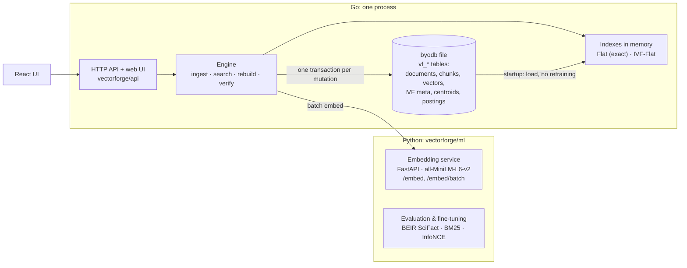

# VectorForge

A semantic search engine and vector database built on byodb, the
copy-on-write B+tree storage engine in this repository. Documents are chunked
by structure, embedded by a local transformer model, stored durably in byodb
tables, and searched with either exact (brute-force) or IVF-Flat approximate
nearest-neighbour search. The IVF index (centroids and posting lists) is
persisted in the same database and loaded, not retrained, at startup.

No external vector database or ANN library is involved: the similarity
kernels, top-k selection, spherical k-means, IVF index, persistence layout,
ingestion pipeline, HTTP API and benchmark harness are all in this repository.



## Results at a glance

Measured on one desktop (Ryzen 5 5600, 6 cores, DDR4-3600, Windows); every
number comes from a file in `results/`, and
[benchmarks.md](../docs/vectorforge/benchmarks.md) explains how.

| what | result |
|---|---|
| exact search, 523k real 384-d embeddings (BEIR Quora) | p50 87.2 ms on one core |
| IVF on the same data | recall@10 0.949 at 2.21 ms (nlist 723, nprobe 16); 0.993 at 16.3 ms |
| what IVF costs in relevance | nDCG@10 −1.6 % at ANN recall 0.91 on Quora; within noise of exact from ANN recall ≈ 0.985–0.99 on Quora and pretrained SciFact |
| persistence, 100k vectors | cold load 1.75 s vs 10.8 s to retrain; reloaded index returns identical results |
| restart test (`scripts/e2e.py`, process killed twice) | 17 of 17 checks pass |
| fine-tuning MiniLM on SciFact (300 held-out test queries) | nDCG@10 0.645 → 0.699, gain CI [+0.037, +0.073]; BM25 0.661 |
| code search on the demo corpus (44 labelled queries) | nDCG@10 0.810 dense vs 0.704 BM25 |
| one HTTP search, 7,478 vectors | p50 13.4 ms, of which 10.2 ms is embedding the query |
| multi-threaded throughput, large collections | levels off at ~30 GB/s of vector reads (≈3× one core): memory-bandwidth bound |

What is not done: HNSW, SIMD and quantization, a FAISS comparison, Docker,
multi-seed training, serving the fine-tuned model, and profiling the slow IVF
persist (24 s for 100k postings).

## Documentation

| document | contents |
|---|---|
| [architecture.md](../docs/vectorforge/architecture.md) | packages, storage layout, write/read paths, startup and recovery, concurrency, API reference, security model, limits |
| [vector-search-design.md](../docs/vectorforge/vector-search-design.md) | the original audit of byodb and the design decisions |
| [ml-methodology.md](../docs/vectorforge/ml-methodology.md) | embeddings, cosine similarity, contrastive fine-tuning, hard negatives, metric definitions, SciFact and code-search results |
| [benchmarks.md](../docs/vectorforge/benchmarks.md) | exact vs IVF across size, dimension, k, nlist, nprobe and concurrency; storage; API latency; methodology |
| [interview-guide.md](../docs/vectorforge/interview-guide.md) | questions and answers about the design, with pointers to evidence |
| [implementation-plan.md](../docs/vectorforge/implementation-plan.md) | stage checklist and implementation log |

## Layout

| path | what |
|---|---|
| `vector/` | dot, cosine, Euclidean, normalization, heap top-k |
| `index/` | `Flat` exact index, spherical k-means, `IVF` index |
| `store/` | the byodb table layout (`vf_*`) and transactional operations |
| `ingest/` | file discovery, Markdown/Go/Python/JS/TS/text chunkers, content hashing |
| `embed/` | HTTP client for the embedding service |
| `engine/` | ties store, indexes and embedder together; consistency rules |
| `api/` | HTTP handlers, validation, security headers, static UI |
| `hrtime/` | 100 ns timer for latency measurement on Windows |
| `synth/` | synthetic clustered/isotropic vectors for benchmarks |
| `ml/` | Python: embedding service, BM25, metrics, BEIR loader, fine-tuning, evaluations |
| `web/` | React + TypeScript UI (search, documents, index dashboard) |
| `scripts/` | `vfctl.py` CLI, `e2e.py` restart test, `apibench.py`, `benchreport.py` |
| `demo/sources.json` | the public demo corpus definition |
| `eval/` | code-search evaluation queries and graded labels |
| `results/` | every measured result, as JSON (and CSV for benchmarks) |
| `../cmd/vectorforge` | the server binary |
| `../cmd/vfbench` | the benchmark harness |

## Running it

Requirements: Go ≥ 1.22, Python ≥ 3.10, Node ≥ 20 (only to build the UI).
Commands are run from the repository root unless noted. On Windows use
`.venv\Scripts\python` in place of `.venv/bin/python`.

### 1. Embedding service

```sh
cd vectorforge/ml
python -m venv .venv
.venv/bin/pip install torch --index-url https://download.pytorch.org/whl/cpu
.venv/bin/pip install -r requirements.txt
.venv/bin/python -m vfml.service --port 8090      # downloads the model once (~90 MB)
```

`curl http://127.0.0.1:8090/health` reports the pinned model ID and dimension.

### 2. Web UI (optional)

```sh
cd vectorforge/web
npm ci
npm run build          # writes vectorforge/web/dist
```

### 3. Server

```sh
go run ./cmd/vectorforge \
  -db vectorforge/runtime/demo.db \
  -sources vectorforge/demo/sources.json \
  -ui vectorforge/web/dist \
  -benchmarks vectorforge/results
```

The database file is created if missing. `-read-only` opens an existing file
without write access (all mutations return 403). The server listens on
`127.0.0.1:8080` by default (`-addr` to change; the market server uses the
same default port, so run one at a time or move one). Other flags: `-nprobe`
(default 8), `-nlist` (default round(√N)), `-auto-train-at` (train IVF after an
ingest once this many vectors exist; default 2000).

### 4. Ingest

Only the directories named in `-sources` can be ingested; the API never
accepts a filesystem path. The demo sources are this repository (minus
generated and evaluation files) and 15 packages of the Go standard library
from the local Go installation: 357 files and 7,478 chunks when last
ingested.

```sh
python vectorforge/scripts/vfctl.py ingest byodb
python vectorforge/scripts/vfctl.py ingest go-stdlib
python vectorforge/scripts/vfctl.py stats
```

Or use the Documents page in the UI. Re-ingesting is incremental: unchanged
files (same content hash, chunker version and model) are skipped, changed
files are replaced atomically, deleted files are removed. Single documents can
also be uploaded through the UI or `POST /api/v1/documents`.

### 5. Search

```sh
python vectorforge/scripts/vfctl.py search "how are torn commits detected" --top-k 5
python vectorforge/scripts/vfctl.py search "retry a request after the connection was reset" --strategy exact
```

or open <http://127.0.0.1:8080>. The Search page can compare exact and IVF
results side by side and shows which exact hits IVF missed. The Index page
shows list sizes, k-means convergence, rebuild and consistency verification,
and renders the benchmark results.

### Tests

```sh
go test ./...                                   # all packages, including the market service
CGO_ENABLED=1 go test -race ./vectorforge/... ./cmd/vfbench
cd vectorforge/ml && .venv/bin/python -m pytest
cd vectorforge/web && npm run build             # includes the TypeScript type check
python vectorforge/scripts/e2e.py               # start, ingest, search, restart, mutate, restart
```

The race detector needs cgo and a C compiler; on Windows, set `CC` to a
MinGW-w64 clang or gcc (llvm-mingw works).

`e2e.py` builds the server, ingests a small corpus copied into a temporary
directory, kills and restarts the process twice, and checks that search
results survive restarts and reflect inserts, updates and deletes. It needs
the embedding service on port 8090.

### Benchmarks and experiments

```sh
go run ./cmd/vfbench -suite synthetic     # 10k/100k/500k vectors, nlist × nprobe sweeps, top-k, concurrency
go run ./cmd/vfbench -suite dims          # 128/384/768 dimensions
go run ./cmd/vfbench -suite storage       # byodb persistence: insert, file size, cold load
cd vectorforge/ml
.venv/bin/python -m vfml.scifact          # BM25 vs pretrained vs fine-tuned (~45 min on 6 CPU threads)
.venv/bin/python -m vfml.export quora     # real 523k-vector embeddings for vfbench -suite real
.venv/bin/python -m vfml.codesearch       # code-search evaluation through the running API
```

Each writes JSON to `vectorforge/results/`; `python
vectorforge/scripts/benchreport.py` renders the tables and charts in
`docs/vectorforge/`.

## Safety defaults

- Listens on loopback by default. Mutations from non-loopback clients require
  `VECTORFORGE_API_TOKEN` (bearer token); cross-origin mutations are rejected.
- Ingestion reads only configured source roots and only recognised file
  types (Markdown, text, Go, Python, JavaScript/TypeScript). It skips
  symlinks, hidden files and directories, dependency/build directories,
  binary content and files over 512 KiB.
- VectorForge only uses its own `vf_*` tables, and refuses to open a database
  file that contains any other application table, so it cannot be pointed at
  the market service's database by mistake.
- The demo database lives in `vectorforge/runtime/` (gitignored).
